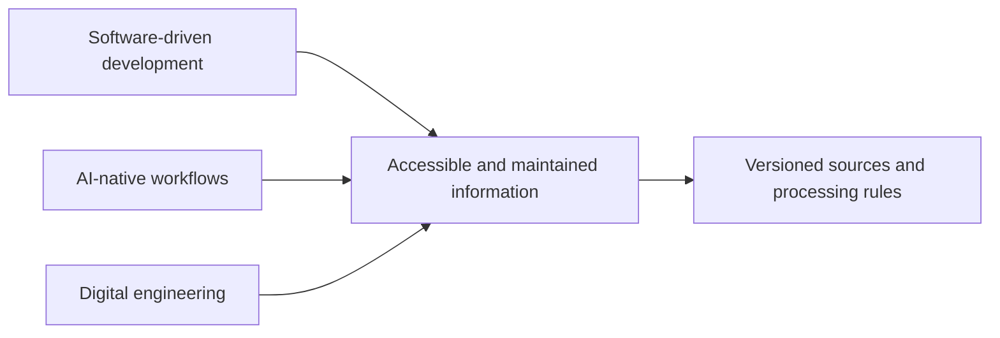
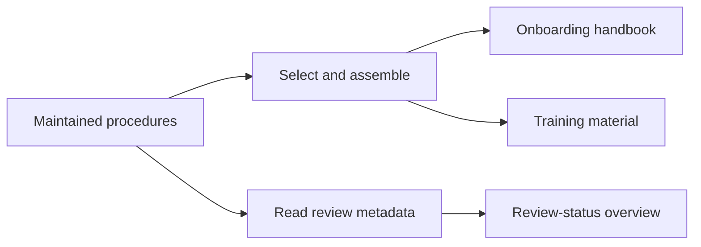

# Document-as-Code: Information We Can Work With

A document is useful when someone can read it. Information becomes more powerful when we can also update, connect, check, and reuse it. **Document-as-Code** applies practices from software development to information: maintain readable sources, record changes, review proposed updates, and automate repeatable work.

This tutorial is both an introduction and a working example. Its source material is maintained as [Markdown files in the repository](https://github.com/And-Gu/document-as-code-lab/tree/main/docs). Astro builds the [reading website](https://and-gu.github.io/document-as-code-lab/) from those same files. The website adds interactive practice and dashboards; GitHub's Markdown preview remains a readable version without those controls.

You may also encounter the term **Docs-as-Code**, particularly for maintaining and publishing documentation. This lab builds on that foundation and emphasizes information that can also be structured, connected, and reused in models, dashboards, and AI workflows. These are related practices, not competing definitions.

## Why now?

**Software-driven development.** Products and services change through frequent software updates. Requirements, procedures, plans, and evidence need to keep pace—not be assembled into disconnected documents long after the work happened.

**AI-native workflows.** AI tools can draft text, inspect files, suggest changes, and run processing steps. To work reliably, they need accessible sources, sufficient context, clear instructions, and results that people can verify. AI increases what is possible; it does not remove the need for ownership and review.

**Digital engineering.** Teams increasingly connect plans, models, interfaces, tests, and operational evidence. That becomes difficult when information is trapped inside separate presentations or documents that cannot be processed together.

These trends do not make Document-as-Code mandatory. They make its central idea more useful: **maintain information in a form that people and tools can work with.**

*Software-driven development, AI-native workflows, and digital engineering all benefit from accessible, maintained information.*

## From a document to maintained information

Consider an onboarding process. New colleagues need instructions for requesting system access, collecting equipment, and finding the right contacts. These instructions can appear in a handbook, training guide, or website.

If each publication contains its own copy, one change to a procedure may require several manual updates. Copies can become inconsistent, and it may be unclear which version has been reviewed.

Instead, we can maintain each procedure as **source information**, with an owner, revision history, and review state. Different outputs can then use the same maintained sources. A handbook and a training guide can reuse approved procedure content; an overview can show which procedures still need review.

The source might be Markdown text, structured data, or both. A document is one way to present that information, not necessarily the only way.

*One set of maintained procedures can support different outputs, including an overview of the information's review state.*

**Reuse of text and information is designed, not automatic.** Saving text in Markdown or GitHub does not eliminate duplication. Someone must decide what information is shared, which source states are acceptable, and how each output uses them.

## Explore the Onboarding Lab

Throughout this tutorial, we use a small fictional onboarding system. It includes three procedures: system access, equipment, and contacts. Each has content and metadata such as an owner and review state. Later chapters show how changes, relationships, checks, and processing can turn these maintained sources into useful results.

### Choose how the information can be used

Access and Equipment are approved in our fictional example; Contacts is still draft. Suppose we want a handbook covering all three procedures. What should qualify for inclusion?

An **approved-content-only** rule selects Access and Equipment but excludes Contacts, leaving the intended handbook incomplete. A rule that **includes drafts for review** allows all three, but the resulting handbook would need to be labelled a review copy. The source statuses stay the same; the rule determines how the information can be used.

The website lets you compare these rules in a **browser-only inclusion preview**. It does not change source statuses or generate a handbook. These are choices for our example, not rules imposed by GitHub or Markdown. Later chapters introduce processing and publication.

<!-- interactive: onboarding-lab -->

### See examples made from the sources

The lab shows how a rule changes which information qualifies for use. To see what different outputs can look like, open these examples already generated from the same [procedure sources](../examples/onboarding-showcase/README.md):

- The [handbook review copy](../assets/onboarding-showcase/handbook.md) combines all three procedures. It includes draft Contacts content, so it is material for review rather than an approved guide for new colleagues.
- The [training excerpt](../assets/onboarding-showcase/training-excerpt.md) selects only the access instructions for a trainer to adapt.
- The [review-status chart](../assets/onboarding-showcase/review-status.png) uses the procedures' review states to show how many are approved and how many still need review.

These are saved examples. Changing the rule in the lab does not update them.

Both examples follow the same principle: **maintained information → explicit rules → useful results**. Later chapters unpack each part.

> **What about task management?** GitHub Issues and Projects can track proposed updates and reviews. Closing an issue does not approve a source revision; approving a procedure does not complete an employee's onboarding tasks. Here, we focus on maintained information and its lifecycle.

## Beyond documentation

The approach above can support checklists, reports, diagrams, simulation inputs, dashboards, and AI-assisted work. It can also help teams review not only information but the rules that process it.

We will explore where information lives, how its changes are recorded, how Markdown and metadata work, and how processing produces different results. You can follow the demonstrations without installing development tools. The actual repository is available for readers who want to inspect the implementation.

Each chapter builds on the onboarding example, introducing new concepts and practical demonstrations along the way.

> **Takeaway:** Document-as-Code is not primarily about writing documents in a different format, tool, or editor. It is about managing information so that it can be maintained, reviewed, traced, reused, and processed by both people and tools.

<!-- interactive: chapter-quiz -->
