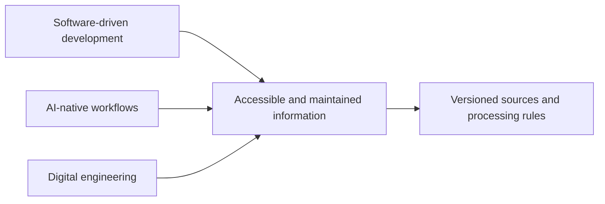
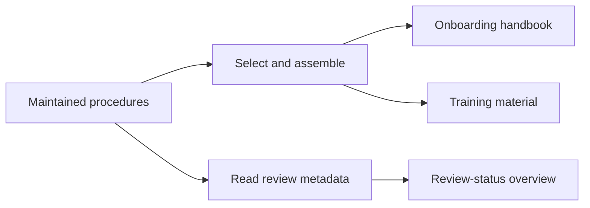

# Document-as-Code: Information We Can Work With

An instruction changes, and the team needs to update a handbook, a training guide, and a website. Could they use one shared source instead of maintaining three copies?

**Document-as-Code** applies practices from software development to that work: keep readable sources, record and review changes, and automate repeatable tasks. The information can then support documents, diagrams, dashboards, and AI-assisted work.

This tutorial is both an introduction and a working example. Its source material is maintained as [Markdown files in the repository](https://github.com/And-Gu/document-as-code-lab/tree/main/docs). Astro builds the [reading website](https://and-gu.github.io/document-as-code-lab/) from those same files. The website adds interactive practice and dashboards; GitHub's Markdown preview remains a readable version without those controls.

## Why now?

Frequent software updates mean that requirements, procedures, and evidence need to keep pace with products and services. This **software-driven development** makes repeated manual updates harder to sustain.

**AI-native workflows** add another reason to make information accessible. AI tools can inspect sources, propose edits, and run processing steps when they have suitable tools and permissions. Clear instructions, relevant context, and reviewable results help people assess that work.

In **digital engineering**, teams connect plans, models, interfaces, tests, and operational evidence. Separate documents remain useful, but their information also needs to work across those connections.

All three benefit from information that people and tools can inspect and process together.

*Software-driven development, AI-native workflows, and digital engineering all benefit from accessible, maintained information.*

## From a document to maintained information

Our fictional onboarding team maintains instructions for requesting system access, collecting equipment, and finding the right contacts. A handbook brings them together for a new colleague; a training guide may need only some of them.

If each publication contains its own copy, one change to a procedure may require several manual updates. Copies can become inconsistent, and it may be unclear which version has been reviewed.

Instead, we can maintain each procedure as **source information**, with an owner, revision history, and review state. Different outputs can then use the same maintained sources. A handbook and a training guide can reuse approved procedure content; an overview can show which procedures still need review.

The source might be Markdown text, structured data, or both. A document is one way to present that information, not necessarily the only way.

*One set of maintained procedures can support different outputs, including an overview of the information's review state.*

**Reuse of text and information is designed, not automatic.** Saving text in Markdown or GitHub does not eliminate duplication. Someone must decide what information is shared, which source states are acceptable, and how each output uses them.

## Explore the Onboarding Lab

The Onboarding Lab uses those three procedures to show how source information can serve different needs. Each procedure includes its instructions and details about ownership and review, which later chapters explain as metadata.

### Choose how the information can be used

Access and Equipment are approved in our fictional example; Contacts is still draft. Suppose we want a handbook covering all three procedures. What should qualify for inclusion?

An **approved-content-only** rule selects Access and Equipment but excludes Contacts, leaving the intended handbook incomplete. A rule that **includes drafts for review** allows all three, but the resulting handbook would need to be labelled a review copy. The source statuses stay the same; the rule determines how the information can be used.

The website lets you compare these rules in a **browser-only inclusion preview**. It does not change source statuses or generate a handbook. These are choices for our example, not rules imposed by GitHub or Markdown. Later chapters introduce processing and publication.

<!-- interactive: onboarding-lab -->

### See examples made from the sources

The lab shows how a rule changes which information qualifies for use. To see what different outputs can look like, open these examples already generated from the same [procedure sources](../examples/onboarding-showcase/README.md):

- The [handbook review copy](../assets/onboarding-showcase/handbook.md) combines all three procedures. It includes draft Contacts content, so it is material for review rather than an approved guide for new colleagues.
- The [training excerpt](../assets/onboarding-showcase/training-excerpt.md) selects only the access instructions for a trainer to adapt.
- The [review-status chart](../assets/onboarding-showcase/review-status.png) uses the procedures' review states to show how many are approved and how many still need review.

These are saved examples. Changing the rule in the lab does not update them.

The inclusion preview and saved outputs follow the same principle: **maintained information → explicit rules → useful results**.

> **What about task management?** GitHub Issues and Projects can track proposed updates and reviews. Closing an issue does not approve a source revision; approving a procedure does not complete an employee's onboarding tasks. Here, we focus on maintained information and its lifecycle.

## Beyond documentation

The approach above can support checklists, reports, diagrams, simulation inputs, dashboards, and AI-assisted work. It can also help teams review not only information but the rules that process it.

You may also encounter **Docs-as-Code**, particularly for maintaining and publishing documentation. This lab builds on that practice and extends the examples to structured records, relationships, and interactive views.

You can follow the demonstrations without installing development tools. We start with onboarding information, then explore agent-ready project knowledge, a fictional contract model, and the actual system behind this website. [Chapter 2](02-github-workspace.md) begins with the shared workspace where the sources and proposed changes live.

> **Takeaway:** Document-as-Code is not primarily about writing documents in a different format, tool, or editor. It is about managing information so that it can be maintained, reviewed, traced, reused, and processed by both people and tools.

<!-- interactive: chapter-quiz -->
