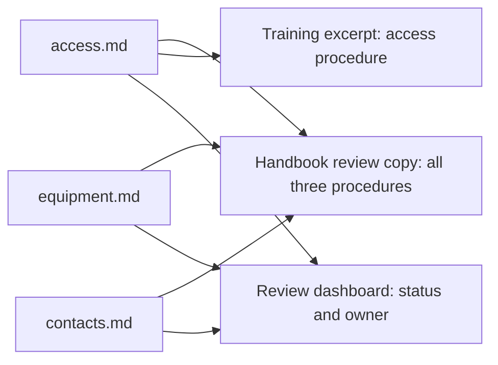
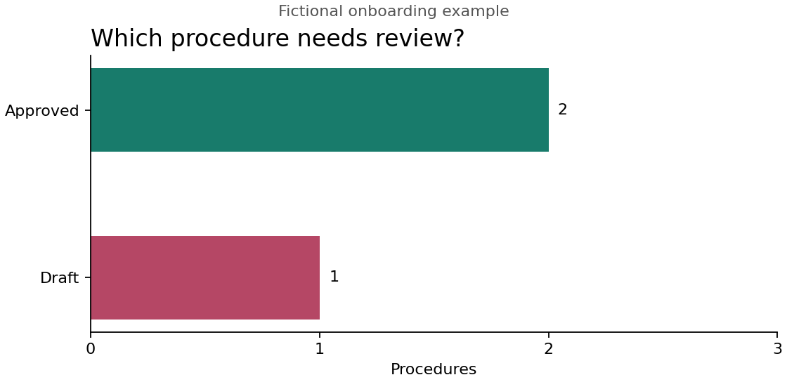

# Document-as-Code: The Living Tutorial

Document-as-Code Lab introduces document-as-code through practical examples. It is also a working demonstration of the approach: the material you are reading is maintained as source files and presented in different forms.

Document-as-code brings software development practices into information work. We maintain editable sources, track and review changes, and automate how information is checked, processed, and published. We can also transform and enrich those sources, for example, incorporating newly reviewed evidence into a dataset and regenerating the pages or visualizations that depend on it. This makes information easier to maintain, reuse, and improve, and provides structured context for AI-assisted work.

This tutorial is maintained in Markdown, a readable plain-text format with simple formatting. You can read the tutorial on GitHub or on its published website. We are also developing PDF output from the same maintained sources. Those sources can also be processed to produce diagrams, charts, dashboards, and presentations. Rather than maintaining separate versions of the content for each format, we maintain the information once and use it wherever it is needed.

## Reading This Tutorial

**GitHub is the main workspace and source of truth.** It holds the Markdown files, related data, scripts, and history of changes. You can read the [source files directly on GitHub](https://github.com/And-Gu/document-as-code-lab/tree/main/docs), inspect how they are organized, and see how they evolve. [Chapter 2](02-github-workspace.md) introduces this shared workspace, called a *repository*.

**The [published website](https://and-gu.github.io/document-as-code-lab/) is another view of those sources.** Built with Astro, it makes the material easier to explore through navigation, styling, diagrams, and interactive components. For example, the expandable **Chapter information** panel displays chapter metadata and recent changes. The website reflects the latest successfully deployed build; changing a file on GitHub does not immediately change the published page. [Chapter 11](11-publishing.md#our-website-uses-astro) explains publishing, including the website and PDF output.

We use a fictional **employee onboarding handbook** throughout the tutorial. It shows how the same instructions can support a handbook, training material, and a review dashboard. Example content is identified as such on the website and in the Markdown source, so readers can distinguish the fictional material from guidance about the tutorial itself. Later chapters examine how to organize sources, collaborate on updates, process information, and publish different outputs. You can follow the ideas without a software development background, or inspect the source files and generation tools in more depth. The [shared vocabulary](../GLOSSARY.md) explains unfamiliar terms.

## Why I Created This Tutorial

I started this tutorial because document-as-code has changed how I work. I have used it in product development, roadmaps, planning, budgeting, and workforce planning. What interests me most is not the format of the documents, but what becomes possible when information is easier to maintain, connect, and use in decisions.

I have also seen that adopting the approach is not simply a matter of introducing new tools. Organizations are often bringing in AI assistants and agentic AI frameworks at the same time, making the change both more promising and more demanding. People need practical examples, confidence in the methods, and a shared understanding of how responsibilities and ways of working may change.

I created this tutorial to share what I have learned, make the opportunities tangible, and help others try the approach in their own work.

## From Source Files to Documents

A *source file* contains information we maintain. A *document* or *view* presents selected information for a particular purpose. Several source files can form one handbook, while the same file can also supply training material or a dashboard.

The value lies in being able to change information at its source and use that change wherever the information is needed. For example, the team responsible for system access can update its instructions without rewriting the whole onboarding handbook. The revised instructions can then be used in both the handbook and training material, while their review status can help generate an overview of what still needs attention. Separate files are useful when they make this kind of ownership, updating, and reuse easier, not because every section needs its own file.

<!-- example:start onboarding -->

## Example: An Onboarding Handbook

Imagine that new colleagues need instructions for requesting system access, collecting equipment, and finding team contacts. The information belongs together in a handbook, but different teams maintain each part. In this **fictional example**, we keep three Markdown files:

| Source file | What it contains | Who maintains it | Status |
| --- | --- | --- | --- |
| [access.md](../examples/onboarding-showcase/access.md) | How to request system access | Onboarding team | Approved |
| [equipment.md](../examples/onboarding-showcase/equipment.md) | How to collect equipment | Workplace team | Approved |
| [contacts.md](../examples/onboarding-showcase/contacts.md) | How to find team contacts | People team | Draft |

These files can provide the text for a combined handbook. The access instructions can also be reused for training, while each file's owner and review status can feed a dashboard. The diagram shows these relationships. A small [script in the project](../scripts/build_onboarding_showcase.py) generates a handbook review copy, an access-only training excerpt, and a chart. For now, notice that **one maintained source can serve different readers and outputs**; later chapters explain the mechanics.

Read the diagram from left to right. Each arrow means "provides information for": all three files supply the handbook, the access file supplies the training excerpt, and metadata from all three supports the dashboard.



*Three files form a handbook review copy; their content and metadata also serve other needs.*

### From a Review Copy to a Published Handbook

The combined [handbook review copy](../assets/onboarding-showcase/handbook.md) is still a draft because `contacts.md` has not been approved. Reusing files does not remove the need to check the resulting publication. Later chapters cover the review and publishing process in detail.

### Reusing the Access Instructions for Training

The same `access.md` file can supply a separate [training excerpt](../assets/onboarding-showcase/training-excerpt.md). A trainer then adapts that material for the audience without having to maintain another copy of the underlying procedure.

### A Dashboard from the Same Files

The files also contain simple *metadata*: descriptive fields such as who owns a procedure and whether it has been approved. The project's script uses that information to generate a status chart. In this fictional dataset, two procedures are approved and one is still a draft.



*These values describe the fictional example, not the tutorial's chapter completion.*

| Procedure | Status | Owner |
| --- | --- | --- |
| Requesting access | Approved | Onboarding team |
| Collecting equipment | Approved | Workplace team |
| Finding team contacts | Draft | People team |

The chart gives a quick overview of progress. The table adds the detail needed to act: it identifies `contacts.md` as the remaining draft and the People team as its owner. Together, they show how information maintained in source files can become a useful overview. In the current example, the script-generated chart is a saved asset and the table is maintained in this chapter; they are **not** automatically synchronized when a source file changes. You can inspect the [input data](../assets/onboarding-showcase/data.json) and [regeneration notes](../examples/onboarding-showcase/README.md). Later chapters explore how to automate such updates.

### Inside the Access Procedure

Here is a simplified source file from our example. It contains both instructions for the reader and metadata for the people and tools maintaining it:

```markdown
---
id: PROC-001
owner: onboarding-team
status: approved
---

# Requesting Access

Submit an access request through the service portal. State which system you
need access to and which team you belong to. Keep the confirmation reference number.
```

The information between the `---` lines is called *metadata*. It tells us which procedure this is (`id`), which team is responsible for it (`owner`), and whether it has been reviewed (`status`). We chose these fields because they are useful in the onboarding example; GitHub and document-as-code do not require them. [Chapter 5](05-structured-content.md) explains how to structure and use metadata.

The procedure text can be reused in a handbook or training material, while its metadata can help track review work. The important point is that both are maintained together in the source file.

<!-- example:end onboarding -->

## Review the Part That Changed

If access instructions change, the team can review that file and consider which outputs depend on it. Git records changes; review and approval are separate activities. [Chapter 9](09-git-review.md) develops the collaboration and review workflows.

## What This Enables in Everyday Work

The example illustrates a broader shift: instead of producing and maintaining each document separately, we can maintain reusable information and build useful outputs from it. Version history helps us understand changes; focused review helps us check updates; scripts can repeat transformations and checks; and visualizations can reveal patterns or work needing attention.

The same source can serve several purposes: the procedure text provides instructions for a handbook and material for training, while its metadata helps a dashboard identify what needs review. AI assistants can also use maintained source information as context, for example, to draft a training explanation for a particular audience. Such a draft still needs to be checked against the source; [Chapter 7](07-ai-native.md) explains how to prepare relevant context for AI-supported work.

More broadly, teams can improve not only their documents but also the templates, data, scripts, and workflows used to maintain them. Teams also need permission, support, and responsibility to improve the tools and workflows around their information.

## When Your Tools Keep Information Inside

So far, our example has used Markdown files that people and tools can read and process directly. In everyday work, however, much of our information lives inside applications. That raises an important question: **can we reuse and process the information itself, or only the output the application lets us see?**

Not all information is equally easy to reuse. Presentations, diagrams, and specialist models may store their editable content inside a particular application. Exporting an image may preserve what it looks like but lose the structure that another tool needs to inspect or process it.

The key question is whether you can access and maintain the *underlying information*, not whether the final result is text or visual. Sometimes that means generating visuals from readable definitions; sometimes it means exporting structured data from a specialist application. [Chapter 8](08-images.md) and [chapter 12](12-beyond-github.md) explore these possibilities in more depth.

## Try It: Find a Reusable Part in Your Own Work

Choose a document, presentation, model, or set of instructions you maintain. You can use paper or your usual note-taking tool.

1. Identify one part that changes independently, such as a procedure, diagram, or data table.
2. Name the person or team best placed to maintain and review it.
3. Describe two documents or views that could use the same information.
4. Choose one useful field, such as owner or review status.
5. Describe how you would check the resulting outputs after a change.

**Expected result:** A small, concrete reuse opportunity. For example: “Our equipment checklist is owned by the workplace team, appears in the handbook and training material, and has a review status that identifies pending work.”

If choosing a part is difficult, start with information you currently copy between files or update on a different schedule from the surrounding content.

**Keep:** A short note naming the information item, its owner, two uses, and the question its metadata could answer. We will return to this example as the tools become more concrete.

Next, [GitHub as a Workspace for Knowledge and Automation](02-github-workspace.md) introduces the environment and your first reviewable change.
