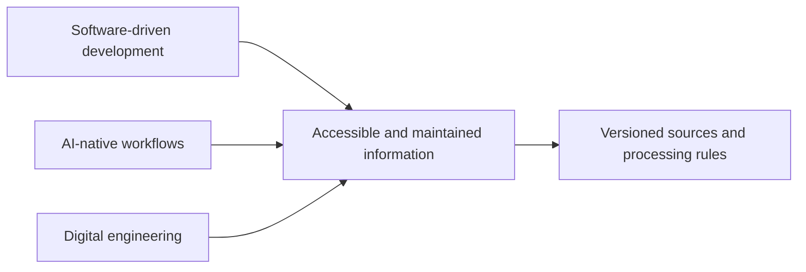
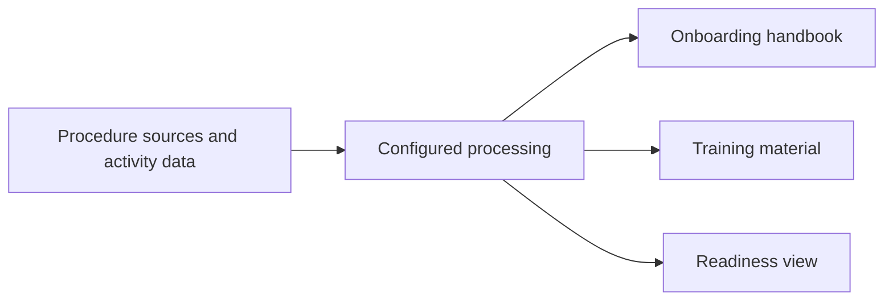

# Document-as-Code: Information We Can Work With

A document is useful when someone can read it. Information becomes more powerful when we can also update, connect, check, and reuse it. **Document-as-Code** applies practices from software development to information: maintain readable sources, record changes, review proposed updates, and automate repeatable work.

This tutorial is both an introduction and a working example. Its source material is maintained as [Markdown files in the repository](https://github.com/And-Gu/document-as-code-lab/tree/main/docs). Astro builds the [reading website](https://and-gu.github.io/document-as-code-lab/) from those same files. The website adds interactive practice and dashboards; GitHub's Markdown preview remains a readable version without those controls.

## Why now?

**Software-driven development.** Products and services change through frequent software updates. Requirements, procedures, plans, and evidence need to keep pace—not be assembled into disconnected documents long after the work happened.

**AI-native workflows.** AI tools can draft text, inspect files, suggest changes, and run processing steps. To work reliably, they need accessible sources, sufficient context, clear instructions, and results that people can verify. AI increases what is possible; it does not remove the need for ownership and review.

**Digital engineering.** Teams increasingly connect plans, models, interfaces, tests, and operational evidence. That becomes difficult when information is trapped inside separate presentations or documents that cannot be processed together.

These trends do not make Document-as-Code mandatory. They make its central idea more useful: **maintain information in a form that people and tools can work with.**

*Three conceptual pressures make accessible, maintained information more useful; this is not a statistical chart.*

## From a document to maintained information

Consider an onboarding process. New colleagues need to request system access, collect equipment, and find the right contacts. These instructions may appear in a handbook, a training guide, or a status overview.

We could maintain each output independently. But when an access procedure changes, someone must find every copy and update it.

A different approach is to maintain the **source information** and use it to produce the views people need. The source might be Markdown text, structured data, or both. A document is then one way to present that information—not necessarily the only way.

*Configured rules connect maintained sources to outputs. The readiness view in the lab is a simulation, not an existing handbook-builder output.*

**Reuse is designed, not automatic.** Saving text in Markdown or GitHub does not eliminate duplication. Someone must decide what information is shared and how each output uses it.

## Explore the Onboarding Lab

Throughout this tutorial, we use a small fictional onboarding system. It starts with three instructions: access, equipment, and contacts. As the tutorial progresses, it gains owners, statuses, dependencies, validation rules, and generated views.

### A fictional change to follow

Suppose system access is delayed while security training is complete. System orientation requires both, so it remains blocked. The readiness view changes when access is completed. These employee task states are separate from the review status of the instructions.

The website offers a browser-only simulation of this scenario. It does not update files, grant access, or approve procedures.

<!-- interactive: onboarding-lab -->

The existing [procedure sources](../examples/onboarding-showcase/README.md) also produce a fixed [handbook review copy](../assets/onboarding-showcase/handbook.md), [training excerpt](../assets/onboarding-showcase/training-excerpt.md), and [review-status chart](../assets/onboarding-showcase/review-status.png). Contacts is still a draft in that example, so the handbook is not an approved publication. These are different from the simulated employee readiness view.

The point is not the dashboard. It is the chain behind it: maintained information → explicit rules → useful results. Later chapters unpack each part.

## Beyond documentation

The same approach can support checklists, reports, diagrams, simulation inputs, dashboards, and AI-assisted work. It can also help teams review not only information but the rules that process it.

We will explore where information lives, how its changes are recorded, how Markdown and metadata work, and how processing produces different results. You can follow the demonstrations without installing development tools. The actual repository is available for readers who want to inspect the implementation.

Choose one instruction, plan, or report from your own work. Keep it in mind as you explore its possible owners, review process, and outputs in later chapters. [The shared vocabulary](../GLOSSARY.md) explains unfamiliar terms.

> **Takeaway:** Document-as-Code is not primarily about writing a document in a different editor. It is about making information maintainable, traceable, reusable, and processable.

<!-- interactive: chapter-quiz -->
