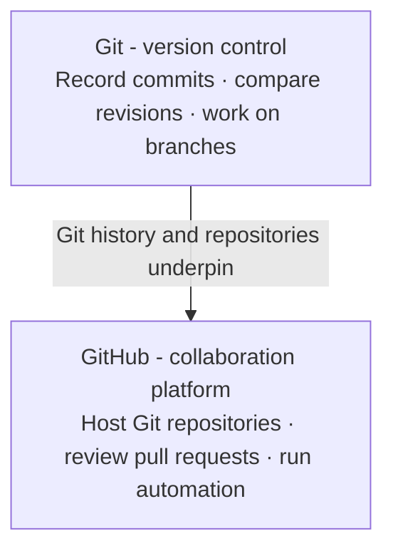
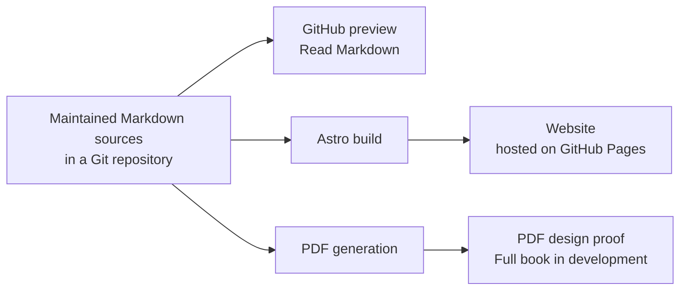
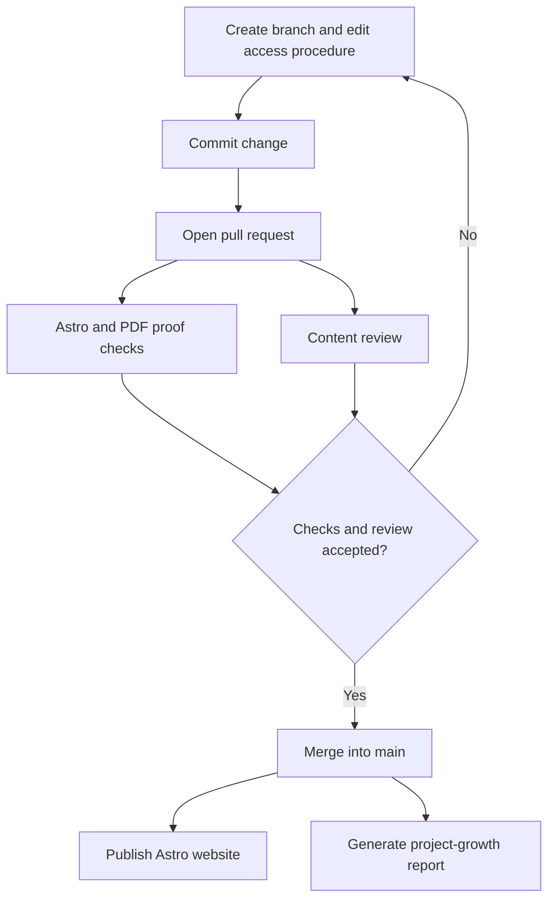

# GitHub as a Workspace for Knowledge and Automation

In document-as-code, we organize maintained information in a **repository**. Think of it as a project folder containing documents, data, diagrams, and instructions for processing them, together with a recorded history of changes.

**Git** is the version-control system that manages this history. It records revisions, makes changes comparable, and lets contributors prepare work separately. **GitHub** hosts Git repositories online and adds tools for sharing information, reviewing proposed changes, coordinating tasks, and running automation.

Together with editors, scripts, and AI assistants, these tools form a **workspace** for maintaining information and improving how it is used. A workspace is not a special Git feature, nor does it have to be hosted entirely on GitHub: it is the broader environment in which the work happens.

This tutorial's repository holds the Markdown chapters, onboarding examples, diagrams, scripts, and publishing configuration. In chapter 1, we explored how a single source can support several outputs. Here we follow what happens when someone updates it. By the end, you should be able to find a source file, inspect a recorded change, and trace an automated result. The core exercise requires only read access.

## More Than a Place to Store Files

A repository brings information, the instructions for processing it, and their history together. If a chart appears incorrect, a team can inspect both its data and the script that produced it. Contributors can work through GitHub or in a local copy with an editor or AI assistant.

### Git and GitHub: Different Roles

Git handles version history, whether the repository is on your computer or hosted online. GitHub builds on Git by providing shared access, pull requests, and automation. **You can use Git without GitHub; GitHub uses Git.**

### One Source, Several Ways to Read It

You can read this tutorial in [GitHub's Markdown preview](https://github.com/And-Gu/document-as-code-lab/tree/main/docs) or on the [Astro website hosted by GitHub Pages](https://and-gu.github.io/document-as-code-lab/). A PDF design proof demonstrates another output; the complete PDF book is still in development. These are different ways to consume information maintained in the same source files. Astro and GitHub Pages are choices made for this project, not requirements of document-as-code.

The distinction matters: updating a source does not automatically update every publication. Each output needs a configured build or publishing process. [Chapter 11](11-publishing.md) explains these processes.

## Find Your Way Around GitHub

Open the [project repository](https://github.com/and-gu/document-as-code-lab) alongside whichever version of the tutorial you are reading. Start with its [README](../README.md), then use this guide:

| Question | Where to look |
| --- | --- |
| Where is the maintained content? | Repository files, such as [the access procedure](../examples/onboarding-showcase/access.md) |
| What changed, and why? | File history, commits, and pull requests |
| What needs attention? | Issues or project boards, if the team uses them |
| How is content processed? | Scripts and workflow definitions |
| Did processing succeed? | Actions runs, logs, and saved artifacts |

## Follow One Proposed Change

<!-- example:start proposed-change -->

### Example: Clarifying the Access Instructions

Suppose the onboarding team wants to improve its access instructions without changing the version currently used by readers.

1. A contributor creates a **branch** and edits the procedure.
2. A **commit** records the change.
3. A **pull request** lets reviewers inspect the **diff** (what changed), discuss the change, and check related outputs.
4. After acceptance, the change is **merged** into `main`.

The diagram connects this review process to automation in our repository: a pull request runs Astro and PDF proof checks; after merging, separate workflows publish the website and generate project-growth reports.

*A branch holds the proposal; build checks and review precede merging, followed by website publication and growth reporting.*

<!-- example:end proposed-change -->

A successful build is not content approval, and merging an updated procedure does not automatically approve the complete handbook. Review requirements depend on repository settings. The onboarding handbook and training excerpt are also **not** rebuilt by these workflows. [Chapter 9](09-git-review.md) develops review and approval further.

## Start in the Browser

Open a Markdown file in GitHub. Compare its formatted preview with the source, then look at its history. If you have edit permission, GitHub's browser editor lets you propose a small change without installing software; branch rules determine how it must be submitted. [Chapter 4](04-markdown.md) explores Markdown in more detail.

## A Few Terms You Will Encounter

| Term | Meaning |
| --- | --- |
| Branch | Separate space for proposed changes |
| Commit | Recorded revision |
| Diff | Comparison of old and new content |
| Pull request | Place to propose, discuss, and review changes |
| Workflow | Configured automated process |
| Runner | Machine executing a workflow job |
| Artifact | Output saved from a workflow run |

## How It Compares with Familiar Tools

Word processors focus on creating and reviewing individual documents. Content management systems organize content for publishing. A repository platform starts with **versioned source files and the instructions that process them**. These tools can overlap; the practical advantage here is being able to review and improve both information and processing together.

## Ownership Close to the Work

Teams often rely on a specialist function to change document templates or workflows. With suitable permissions, a repository lets the people maintaining information also improve its checks, visualizations, and publishing routines. For example, the onboarding team could add a report of procedures awaiting review. That freedom also brings responsibility for testing, access control, and maintenance.

## Automation as Part of the Workspace

**GitHub Actions** executes configured workflows on events such as a pull request or an update to `main`. A **runner** executes each job; workflow definitions live in `.github/workflows/`.

In this project, a pull request triggers an Astro build check and a separate PDF proof build. The PDF workflow renders Mermaid diagrams and saves review artifacts; it can also run manually. After changes reach `main`, separate workflows publish the website and generate growth reports. The website build also refreshes the Project Control Center's growth data, introduced in chapter 3. The onboarding handbook and training excerpt still require someone to run their script. A successful workflow confirms that its configured tasks ran, not that the content is correct or approved. [Chapters 6](06-processing.md), [11](11-publishing.md), and [13](13-automation.md) explain execution and publishing in detail.

## AI Can Help You Build the Process

An AI coding agent can inspect related files, revise content, update a script, and run checks. A repository gives it useful context: chapters, metadata, examples, and project instructions. For instance, a change to an access procedure may also affect a training excerpt or validation rule.

Describe the intended change, its inputs, and what would count as success. Ask the agent to propose small, reviewable updates, and inspect its diffs and test results. Repository access alone does not guarantee that an agent understands every dependency. [Chapter 7](07-ai-native.md) covers context and coordinated maintenance.

## Try It: Follow a Change Through the Workspace

Explore an existing change in the public tutorial repository:

1. Open this chapter in GitHub and compare Markdown source with its preview.
2. Open [pull request #1](https://github.com/And-Gu/document-as-code-lab/pull/1). Inspect changes to `docs/01-introduction.md` and find a status change and a wording improvement.
3. Find the merge commit `3c5ab277f3073d8fe0ba69d823e494491d12db78`. Check the [growth workflow run](https://github.com/And-Gu/document-as-code-lab/actions/runs/37230719162) and [Pages deployment](https://github.com/And-Gu/document-as-code-lab/actions/runs/37230719137) for that revision.
4. If its growth-report artifact is available, check the recorded source commit. Artifacts may expire; the repository includes a [saved report](../assets/figures/growth-first-update/history.json) from a **different** revision (`9c91191`) for comparison, not as evidence of this merge.

Downloading artifacts requires signing in with read access. If an artifact has expired, record that limitation and use the saved report to inspect its structure.

**Expected result:** Identify a source file, its reviewed change, and a processing result. Do not mistake a successful build for approval.

**Keep:** A short note with the file path, commit, available run link, and what you observed. Then consider where the reusable information from your chapter 1 exercise would live and who should review it. Use fictional material if necessary to protect confidential information.

## Optional: Propose Your Own Change

For local setup, use [GitHub's setup guide](https://docs.github.com/en/get-started/git-basics/set-up-git) and [cloning guide](https://docs.github.com/en/repositories/creating-and-managing-repositories/cloning-a-repository). A downloaded ZIP does not contain the history needed for growth measurements.

In a repository you can edit, improve one sentence on a branch, inspect the diff, and commit it with a meaningful message. If appropriate, open a pull request. Merging is not required for this exercise. Chapter 9 develops the review workflow; the [measurement reference](../reference/growth-measurement.md) explains how to trace generated results to a revision.

## Other Environments

GitLab and Bitbucket offer related repository practices, though details differ. The essential connection is between **the maintained source, the reviewed change, and the processing result**. Next, [chapter 3](03-project-growth.md) introduces the Project Control Center and its views of repository activity and growth.
