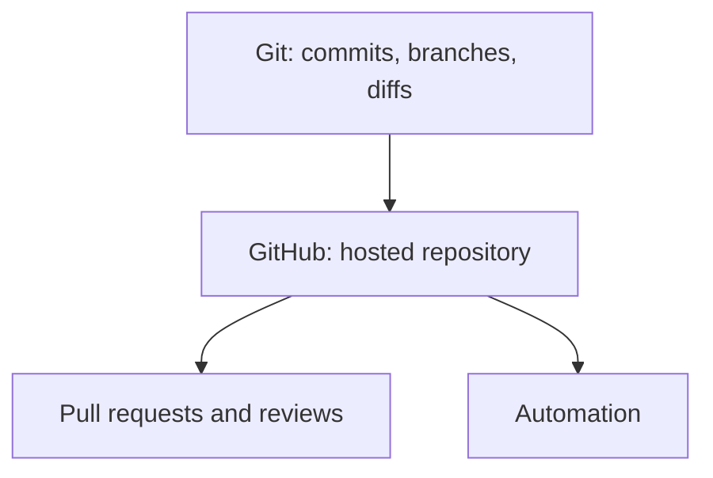
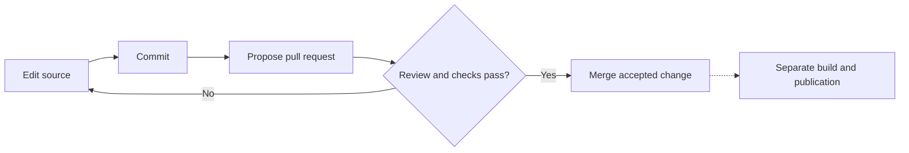

# A Shared Workspace for Information

Suppose the access procedure from chapter 1 needs a new step. The author needs somewhere to prepare the change, colleagues need to review it, and everyone needs to know which version they are reading.

This tutorial uses a **Git repository hosted on GitHub** for that work. The repository keeps the source files and their history together. Git records revisions, while GitHub provides a shared place to propose and review changes.

## Repository, Git, and GitHub

A **repository** is a collection of maintained files and their change history. It can hold documentation, structured data, diagrams, tests, and the instructions that process them.

**Git** records changes to those files, preserving their history so that people can compare versions and work on changes separately.

**GitHub** hosts repositories and adds collaboration tools, including pull requests, access management, and automation. Git and GitHub are not synonyms: Git can work without GitHub, and comparable hosted platforms also exist.

*Git records versions; GitHub hosts the repository and adds collaboration and automation.*

Authors can edit directly on GitHub or use an editor or AI agent with a copy stored on their computer. Local changes must be sent to GitHub before colleagues can review them there. Together, the repository, editors, people, and workflows form the team's **workspace**.

## Branches, Commits, and Pull Requests

Changes move from an author's working version into the shared source through a few distinct steps:

- **Branch:** A separate line of work where changes can be prepared without changing `main`, the shared baseline.
- **Commit:** A recorded set of changes, with a message explaining what changed.
- **Diff:** A comparison showing the lines added, changed, or removed.
- **Pull request (PR):** A proposal to bring changes from one branch into another, with discussion, review, and checks.
- **Merge:** Incorporating those changes into the target branch, usually `main`.

## Follow a proposed change

For the new access step, the contributor edits the source on a branch and commits the change. A pull request presents it for review: colleagues can compare the wording with the earlier version, discuss the proposed step, and check affected outputs.

After acceptance, the change can be merged into the main branch. This updates the maintained source. Any published output changes only when its build or publishing process runs successfully.

*Recording, reviewing, merging, and publishing are separate steps.*

The new step can therefore be recorded before it is accepted, and accepted before it reaches readers:

- **Recorded:** Git remembers a revision.
- **Reviewed:** Someone has inspected and accepted a proposed change.
- **Published:** Readers can access a resulting output.

Checks help reviewers assess the proposal. A successful build does not decide whether the new instruction is correct.

## The Onboarding Lab in the repository

Our example has procedure files such as `access.md`, `equipment.md`, and `contacts.md`. See the [maintained procedure files](../examples/onboarding-showcase/README.md). Those files are sources, not separate copies of every handbook or presentation that uses them. As the lab grows, related configuration, data, tests, and processing code can live alongside them.

## Explore without installing anything

In the [real repository](https://github.com/And-Gu/document-as-code-lab), start with the [README](../README.md), locate the chapter and onboarding files, and look at the history of one file. Reading and exploring should not require creating an account. Modifying a repository is an optional advanced activity.

Alongside the chapter files, you will find rules for checking changes and publishing results. A proposed edit can trigger a website build check; an edit merged into `main` can trigger publication. GitHub Actions runs these operations, which we follow in [chapter 10](10-publishing.md).

With suitable permissions, the team can improve these rules alongside the information. An AI agent can use both as context when helping with changes, while people remain responsible for reviewing the results and maintaining the tools.

> **Explore further:** Want to inspect a proposed change? The [collaboration guide](../reference/review-and-collaboration.md) explains diffs, review scope, and approval boundaries. Its optional contribution steps are separate from the browser-first tutorial.

**The repository holds the sources, Git records their history, and GitHub provides a shared place to work with them.** Once a change is recorded, that history can help us understand more than the latest wording.

<!-- interactive: chapter-quiz -->

[Chapter 3](03-project-growth.md) follows a revision and the evidence it leaves behind.
