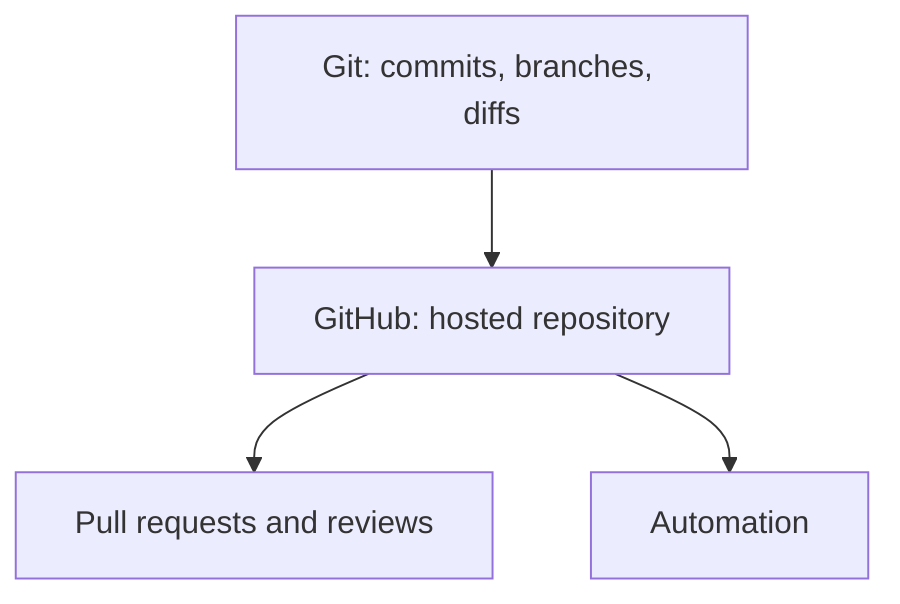
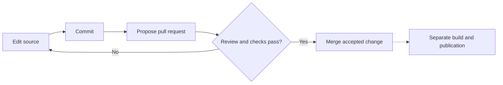

# A Shared Workspace for Information

When information matters to several people, they need to know where it lives, what changed, and which version to trust. In this tutorial, we use a **Git repository hosted on GitHub** as our shared workspace.

## Repository, Git, and GitHub

A **repository** is a collection of maintained files and their change history. It can hold documentation, structured data, diagrams, tests, and the instructions that process them.

**Git** records changes to those files. A *commit* identifies a recorded revision. A *branch* lets someone prepare changes separately. A *diff* shows what changed between versions.

**GitHub** hosts repositories and adds collaboration tools, including pull requests, access management, and automation. Git and GitHub are not synonyms: Git can work without GitHub, and comparable hosted platforms also exist.

*Git records versions; GitHub hosts the repository and adds collaboration and automation.*

A **workspace** is broader than the repository itself. It includes the editors, people, workflows, and tools used to maintain the information. In our example, GitHub is the shared hub, but an editor or AI assistant may work with a local copy.

## Follow a proposed change

Suppose the access instructions need a new step. The contributor edits the source on a branch and commits the change. A pull request presents the proposed change for review. Reviewers can compare versions, discuss the wording, and check whether related outputs still work.

After acceptance, the change can be merged into the main branch. This updates the maintained source. Any published output changes only when its build or publishing process runs successfully.

*Recording, reviewing, merging, and publishing are separate steps.*

Three things are different:

- **Recorded:** Git remembers a revision.
- **Reviewed:** Someone has inspected and accepted a proposed change.
- **Published:** Readers can access a resulting output.

One does not automatically guarantee the others. A successful build shows that configured checks ran; it does not establish that the content is correct or approved.

## The Onboarding Lab in the repository

Our example has procedure files such as `access.md`, `equipment.md`, and `contacts.md`. See the [maintained procedure files](../examples/onboarding-showcase/README.md). Those files are sources, not separate copies of every handbook or presentation that uses them. As the lab grows, related configuration, data, tests, and processing code can live alongside them.

## Explore without installing anything

In the [real repository](https://github.com/And-Gu/document-as-code-lab), start with the [README](../README.md), locate the chapter and onboarding files, and look at the history of one file. Reading and exploring should not require creating an account. Modifying a repository is an optional advanced activity.

GitHub Actions, runners, and deployment configuration become important later, when we examine processing and publishing. With suitable permissions, a team can maintain its processing rules as well as its information. Agents can use those files and repository instructions as shared context, but the team still needs to review results and maintain its tools.

For now, remember the essential relationship: **the repository holds maintained sources; Git records their history; GitHub provides a shared place to work with them.**

<!-- interactive: chapter-quiz -->

Next, [chapter 3](03-project-growth.md) connects recorded history to useful reports.
