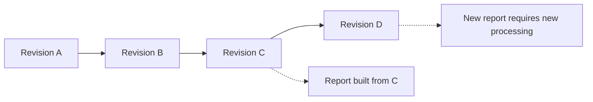

# History Is Useful Information

A change history is more than an archive. It helps teams understand what changed, when it changed, and which results came from a particular revision.

## What does Git remember?

A commit records a snapshot of tracked files and a message explaining the change. Comparing two commits reveals additions, removals, and edits. This is useful when a procedure evolves: reviewers can focus on what changed instead of rereading a complete handbook.

In the Onboarding Lab, imagine that `access.md` gains an extra verification step. We can inspect the diff, identify the revision that introduced it, and compare it with the previous procedure. If a generated guide behaves unexpectedly, its source revision gives us a starting point for investigating why.




*Fictional revisions A to D show how a report remains tied to the revision used to build it.*


## History connects sources to outputs

Suppose we generate an onboarding report from the latest accepted sources. A useful report records which source revision it used. Without that reference, readers may struggle to explain why two reports disagree.

This is **traceability**: being able to connect a result to the information and processing used to produce it. A source revision is one part of that connection. For stronger reproducibility, we may also need the processing code, parameters, tool versions, and external inputs.

A report that says *“built from revision B”* is more useful than one that says only *“updated recently.”*

## Can we measure progress from the history?

Version history can supply useful observations: the number of changed files, contributions over time, or the age of an unresolved update. Automated reports can show these trends.

But activity is not the same as value. More commits do not necessarily mean better information. A small correction to a critical procedure may be more useful than a large formatting change. Commit counts can also be distorted by different working styles.

Use history measures to ask better questions, not to rank people or declare quality by counting edits.

## Explore the actual project

Open the [Project Control Center](https://and-gu.github.io/document-as-code-lab/dashboard/) to inspect chapter and word counts, capability history, commits, and operational snapshots. Growth data is measured from committed history during website builds. The operational snapshot records its retrieval time and can lag behind current GitHub activity; optional live retrieval is separate.

These are observations about this repository, not evidence that every chapter is approved or that a larger word count means higher quality. The [dashboard guide](../reference/dashboards-and-work-tracking.md) develops dashboard design and interpretation. The [measurement reference](../reference/growth-measurement.md) explains the counting rules and saved historical charts.

Chapter word counts cover `docs/`, not the linked reference guides. Moving detailed exercises into those guides reduces the measured chapter text without deleting the material. Website growth data reflects committed revisions and is refreshed during deployment.

## Explore a change

The following comparison is fictional, not a change claimed to exist in the repository's history.

```diff
- Request access from your line manager.
+ Submit an access request through the service portal.
+ Include your team and the system you need.
```

Which revision should the training guide use? The answer depends on which revision has been accepted and which publishing process has run—not simply which text was edited last.

## What to remember

Git gives us a recorded history and comparisons. When we connect that history to generated results, it supports review, investigation, and traceability. It does **not** independently prove accuracy, approval, or usefulness.

In [chapter 4](04-markdown.md), we inspect the readable source format used throughout this tutorial: Markdown.

<!-- interactive: chapter-quiz -->
