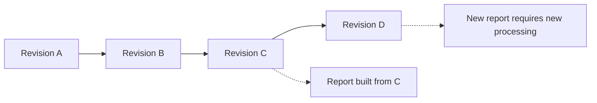

# History Is Useful Information

A change history is more than an archive. It helps teams understand what changed, when it changed, and which results came from a particular revision.

## What does Git remember?

A commit records a snapshot of tracked files and a message explaining the change. Comparing two commits reveals additions, removals, and edits. This is useful when a procedure evolves: reviewers can focus on what changed instead of rereading a complete handbook.

In the Onboarding Lab, imagine that `access.md` gains an extra verification step. We can inspect the diff, identify the revision that introduced it, and compare it with the previous procedure. If a generated guide behaves unexpectedly, its source revision gives us a starting point for investigating why.




*Fictional revisions A to D show how a report remains tied to the revision used to build it.*


## Who changed, reviewed, and approved the information?

History also connects changes to people. Git records author and committer information for each commit. GitHub pull-request reviews record the reviewer's account and decision against a particular revision. This helps a team find who proposed a change, who reviewed it, and where questions were resolved.

For approval, the important question is not just **who**, but **who approved which revision**. Keep the decision with the review or change record. A later edit is not automatically covered by an earlier approval. These records support accountability and follow-up, not a ranking of contributors by activity.

## History connects sources to outputs

Suppose we generate an onboarding report from the latest accepted sources. A useful report records which source revision it used. Without that reference, readers may struggle to explain why two reports disagree.

This is **traceability**: being able to connect a result to the information and processing used to produce it. A source revision is one part of that connection. For stronger reproducibility, we may also need the processing code, parameters, tool versions, and external inputs.

A report that says *“built from revision B”* is more useful than one that says only *“updated recently.”*

## Can we measure progress from the history?

Version history can supply useful observations: the number of changed files, contributions over time, or the age of an unresolved update. Automated reports can show these trends.

But activity is not the same as value. More commits do not necessarily mean better information. A small correction to a critical procedure may be more useful than a large formatting change. Commit counts can also be distorted by different working styles.

Use history measures to ask better questions, not to rank people or declare quality by counting edits.

## When AI increases the pace of change

An AI agent can propose changes across many files in a short time. One request might update a procedure, related chapters, metadata, and processing code. Reviewing only the final text of one file can miss changes elsewhere.

This makes clear diffs, focused proposals, and recorded review decisions more important. Reviewers need to understand what changed, why, and which related sources or outputs may be affected. Automated checks can catch broken links or invalid fields, but people still need to assess meaning and consistency. A large change may need to be split into smaller proposals so each can be reviewed properly.

AI assistance does not remove responsibility: the team still needs to know who is accountable for the proposed change and who reviewed it.

## Explore the actual project

Information about changed files, chapter review states, pending updates, and check results can support **data-driven project management**: using evidence about the work to decide where to focus attention. Which chapters still need review? Has a proposed update been waiting for a decision? Did the latest changes pass the publishing checks? The aim is to support decisions, not simply display more numbers.

Open the [Project Control Center](https://and-gu.github.io/document-as-code-lab/dashboard/) to inspect chapter and word counts, capability history, commits, and operational snapshots. Growth data is measured from committed history during website builds. The operational snapshot records its retrieval time and can lag behind current GitHub activity; optional live retrieval is separate.

Choose one observation and ask what action it suggests. A rise in word count shows that text was added; it does not tell us whether the material is ready for readers. Review states and change records provide context for deciding what to inspect next. The dashboard brings together some of this evidence; other questions require looking at the sources or review discussions.

Read the figures in context. A chapter's review status tells us whether it has been approved; its word count tells us only how much text it contains.

> **Explore further:** Trace the dashboard figures to their source revision and counting rules in the [measurement guide](../reference/growth-measurement.md). Reading needs no setup; reproducing a measurement uses its optional local Python environment. The [dashboard guide](../reference/dashboards-and-work-tracking.md) develops design and interpretation.

## From project trends to one change

An overview of pending updates can help us choose which change to review next. A diff then shows exactly what text has changed.

For example, imagine updating the access instructions from chapter 1 so that colleagues submit requests through a service portal instead of contacting their line manager. In the diff below, a minus sign marks removed text; a plus sign marks added text.

```diff
- Request access from your line manager.
+ Submit an access request through the service portal.
+ Include your team and the system you need.
```

The diff shows what reviewers need to assess. Recording the source revision used in the training guide tells us which instructions readers received.

## What to remember

Git gives us a recorded history and comparisons. When we connect that history to generated results, it supports review, investigation, and traceability. It does **not** independently prove accuracy, approval, or usefulness.

In [chapter 4](04-markdown.md), we inspect the readable source format used throughout this tutorial: Markdown.

<!-- interactive: chapter-quiz -->
