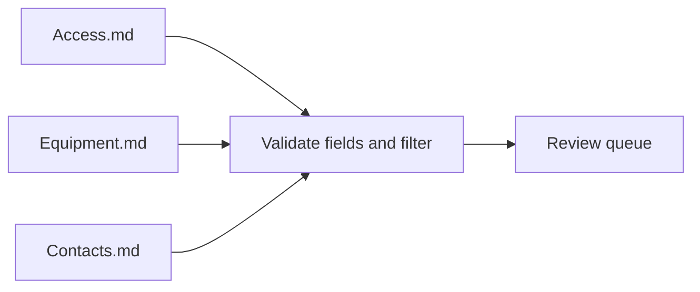

# Structure Makes Information Actionable

Markdown tells a reader what to do. Structured information tells software what an item *is*, who owns it, and how it relates to other items.

In our Onboarding Lab, the text of the access procedure is useful to a new employee. The team maintaining the procedure also needs to know its owner, identity, and review status.

## Metadata: information about information

A Markdown file can begin with structured fields, often called **frontmatter**:

```markdown
---
id: PROC-001
owner: onboarding-team
status: approved
---

# Requesting System Access

Submit a request through the service portal.
```

The `---` lines separate metadata from the main text. The example uses YAML, a common text format for structured fields. These names and values are choices made for our project; GitHub does not require them.

The text describes a procedure. The metadata identifies that procedure and records how it is maintained. Keeping both together makes it easier to inspect the information in context.

## From fields to useful views

Once multiple procedures use consistent fields, software can answer practical questions: Which procedures are drafts? Who owns them? Which item needs review?




*Validation and filtering turn procedure metadata into a review queue when processing runs.*

These are the current fictional [showcase procedure sources](../examples/onboarding-showcase/README.md):

| Procedure | Owner | Review status |
| --- | --- | --- |
| System access | Onboarding team | Approved |
| Equipment | Workplace team | Approved |
| Contacts | People team | Draft |

A status view can identify **Contacts** as the item needing review. Unlike an independently maintained chart, a computed view can stay aligned with the source data whenever the processing runs.

## Agree on meaning, not just field names

Structure works only when fields mean the same thing across files. Does `approved` mean a procedure has passed content review? Who may change it? Is an owner a person or a team? What happens if a field is missing?

Validation can check simple rules such as a required `id`, an allowed `status` value, or a unique identifier. It cannot decide whether the underlying procedure is sensible or safe.

An authoring [template](../examples/structured-content/templates/requirement.md) provides a consistent starting layout. A [schema](../examples/structured-content/schema.yaml) expresses rules that a compatible processor can check. A saved YAML file does not validate records by itself. Our requirement schema does not apply to the procedure example above.

**Do not confuse two statuses:** a procedure may be approved while an individual employee's onboarding task remains unfinished. Document review and operational completion belong to different information records.

## Relationships extend the model

Some onboarding activities depend on others. System orientation may require completed access and security training. Those dependencies should be recorded explicitly if software is expected to identify blocked activities.

We do not need a large modeling language to express a small relationship. We do need stable identifiers, agreed meanings, and validation appropriate to the risk.

<!-- interactive: metadata-lab -->

The website demonstration changes a practice copy of Contacts and refreshes its review queue only after Run checks and build. If its owner is missing, validation fails and the previous result is labelled as such. It does not approve or edit the repository's procedure.

For a runnable requirement example, inspect [REQ-014](../examples/structured-content/records/REQ-014.md) and the [template and record guide](../reference/record-processing.md#templates-and-requirements). The later AI and diagram exercises use those requirement, task, and test records rather than employee onboarding task data.

## What to remember

**Structure lets software interpret information consistently.** [Chapter 6](06-information-architecture.md) introduces identities and relationships. [Chapter 7](07-processing.md) shows how processing uses that structure to create outputs and perform checks.

<!-- interactive: chapter-quiz -->
