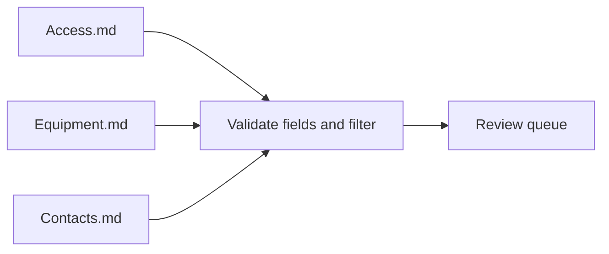

# Structure Makes Information Actionable

Our onboarding example has three procedures. Two are approved; one still needs review. How could we find the draft without opening every file?

Give each procedure a few consistent fields, such as an identifier, owner, and review status, and a program can find it. These fields are **metadata**: information about the procedure, maintained alongside the instructions.

## Metadata: information about information

The new colleague needs the access instructions; the team maintaining them also needs to know their identity, owner, and review state. In Markdown, these details can sit in an opening block called **frontmatter**. Here we write them using **YAML**, a text format for structured information:

```markdown
---
id: PROC-001
owner: onboarding-team
status: approved
---

# Requesting System Access

Submit a request through the service portal.
```

The `---` lines mark the frontmatter block. YAML is not limited to frontmatter: it can also be used in separate files for configuration, data records, and presentation definitions. Frontmatter describes where the metadata sits; YAML describes how its fields are written. These field names and values are choices made for our project; GitHub does not require them.

The instruction explains how to request access. The `id` gives the procedure a stable reference, `owner` names the responsible team, and `status` records its review state. Readers can see these details alongside the instruction, while software can read the fields without having to infer them from the prose.

## From fields to useful views

Once multiple procedures use consistent fields, software can answer practical questions: Which procedures are drafts? Who owns them? Which item needs review?




*Validation and filtering turn procedure metadata into a review queue when processing runs.*

These are the current fictional [showcase procedure sources](../examples/onboarding-showcase/README.md):

| Procedure | Owner | Review status |
| --- | --- | --- |
| System access | Onboarding team | Approved |
| Equipment | Workplace team | Approved |
| Contacts | People team | Draft |

A status view can identify **Contacts** as the item needing review. Unlike an independently maintained chart, a computed view can stay aligned with the source data whenever the processing runs.

## Agree on meaning, not just field names

Structure works only when fields mean the same thing across files. Does `approved` mean a procedure has passed content review? Who may change it? Is an owner a person or a team? What happens if a field is missing?

Once the team agrees on these meanings, it can turn some of them into rules that software checks. This is called **validation**. For example, a check can flag a missing `id`, a duplicated identifier, or a `status` value outside the agreed list. These checks help keep the records consistent; people still need to judge whether the procedure itself is sensible and safe.

A [template](../examples/structured-content/templates/requirement.md) helps an author create a consistent record. A [schema](../examples/structured-content/schema.yaml) defines what a program should check: for example, whether an identifier is present and whether the status uses an allowed value.

The schema is a set of rules, not a running check. A validator must apply those rules to the intended files. In the lab below, **Validate metadata** runs that check on the procedure in the editor.

Different records can need different rules. The linked requirement template and schema belong to the REQ-014 example; the onboarding editor uses its own procedure schema.

<!-- interactive: scenario-check-metadata -->

Keep the distinction between a starting layout, rules, and a running check in mind as you use the editor. The [shared vocabulary](../GLOSSARY.md) collects the terms introduced here.

## Try schema validation

Use the Markdown editor from chapter 4 to edit a practice copy of Contacts, this time including its YAML frontmatter. The [practice schema](../examples/learning/procedure.schema.json) requires an identifier such as `PROC-003`, an owner containing text, and a status of `draft` or `approved`. It also rejects extra fields. The editor uses this schema when you select **Validate metadata**.

Try these changes to the metadata in the source editor:

1. Change `status: draft` to `status: unknown`, then select **Validate metadata**. The check rejects `unknown` because the schema allows only `draft` or `approved`.
2. Change the status back to `draft`, remove the `owner` line, and validate again. This time, the check reports a missing required field.
3. Restore `owner: people-team` and validate. The metadata passes: `draft` is an allowed value, not evidence that the procedure is approved.

The preview shows the procedure text separately from its metadata. Use the reset button to restore the original example at any time.

Edits stay in your browser. The check applies only to this file's metadata; it does not save the practice copy, generate a handbook, or assess the instruction's accuracy.

<!-- interactive: metadata-lab -->

> **Explore further:** Want to run validation on maintained requirement records? The [template and record guide](../reference/record-processing.md#templates-and-requirements) follows [REQ-014](../examples/structured-content/records/REQ-014.md) through the local processor. Reading needs no setup; running it requires a checkout, Python, and the linked dependencies.

The lab shows why fields need both a shared meaning and configured checks. A draft can be valid metadata without being approved content.

Metadata can also identify another information item, such as a policy referenced by a procedure. [Chapter 6](06-information-architecture.md) follows those relationships to see what may need review when a source changes.

<!-- interactive: chapter-quiz -->
