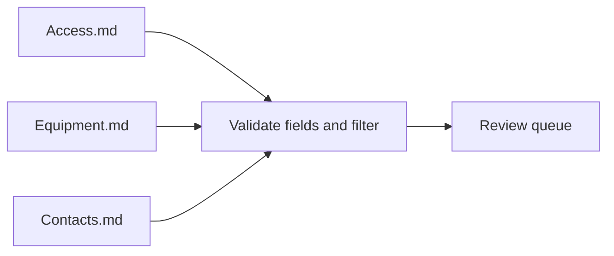

# Structure Makes Information Actionable

Chapter 4 introduced Markdown as a way to write readable text with headings, lists, and tables. We can also add structured fields that software can read directly, such as a procedure's identifier, owner, and review status.

Consider the access procedure from our Onboarding Lab. A new colleague reads the instructions to request access. The team maintaining those instructions needs to know who is responsible for them and whether they have been reviewed. Recording those details in consistent fields lets software group procedures by owner or find those awaiting review.

## Metadata: information about information

**Metadata** describes the content: for example, which procedure a file contains, who owns it, and its review state. In a Markdown file, we can place these details in a block at the beginning, called **frontmatter**. Here, we write the fields using **YAML**, a text format for structured information:

```markdown
---
id: PROC-001
owner: onboarding-team
status: approved
---

# Requesting System Access

Submit a request through the service portal.
```

The `---` lines mark the frontmatter block. YAML is not limited to frontmatter: it can also be used in separate files for configuration, data records, and presentation definitions. Frontmatter describes where the metadata sits; YAML describes how its fields are written. These field names and values are choices made for our project; GitHub does not require them.

The instruction explains how to request access. The `id` gives the procedure a stable reference, `owner` names the responsible team, and `status` records its review state. Readers can see these details alongside the instruction, while software can read the fields without having to infer them from the prose.

## From fields to useful views

Once multiple procedures use consistent fields, software can answer practical questions: Which procedures are drafts? Who owns them? Which item needs review?




*Validation and filtering turn procedure metadata into a review queue when processing runs.*

These are the current fictional [showcase procedure sources](../examples/onboarding-showcase/README.md):

| Procedure | Owner | Review status |
| --- | --- | --- |
| System access | Onboarding team | Approved |
| Equipment | Workplace team | Approved |
| Contacts | People team | Draft |

A status view can identify **Contacts** as the item needing review. Unlike an independently maintained chart, a computed view can stay aligned with the source data whenever the processing runs.

## Agree on meaning, not just field names

Structure works only when fields mean the same thing across files. Does `approved` mean a procedure has passed content review? Who may change it? Is an owner a person or a team? What happens if a field is missing?

Once the team agrees on these meanings, it can turn some of them into rules that software checks. This is called **validation**. For example, a check can flag a missing `id`, a duplicated identifier, or a `status` value outside the agreed list. These checks help keep the records consistent; people still need to judge whether the procedure itself is sensible and safe.

An authoring [template](../examples/structured-content/templates/requirement.md) provides a consistent starting layout. A [schema](../examples/structured-content/schema.yaml) defines the rules for the records. To check those records, a program must read the schema and apply its rules to the selected files. Saving the schema does not start that check automatically.

The linked template and schema are examples for requirement records, such as REQ-014. They are not configured to check the onboarding procedures shown here. The editor exercise below uses a separate schema for procedure metadata.

## Concepts so far

| Concept | Meaning | Example |
| --- | --- | --- |
| Source text | The content someone reads. | Instructions for requesting access. |
| Structured field | A named value that software can read directly. | `owner: onboarding-team` |
| Record | Information maintained as one identifiable item. | A procedure with its text and metadata. |
| Metadata | Information describing the content. | Its identifier, owner, and review status. |
| Frontmatter | A metadata block at the beginning of a Markdown file. | Fields between the opening `---` lines. |
| YAML | A text format for structured information, used in frontmatter or separate files. | `status: approved` |
| Identifier | A stable reference for an item. | `id: PROC-001` |
| Owner | The person or team responsible for maintaining an item. | `owner: onboarding-team` |
| Review status | The recorded state of the content's review. | `draft` or `approved` |
| Authoring template | A starting layout for creating consistent records. | The linked requirement template. |
| Schema | Rules describing the fields and values a record may contain. | The linked schema for requirement records. |
| Validation | Checking records against defined rules. | Flagging a missing identifier or an invalid status. |
| Processing | Running software to read, check, or transform sources. | Selecting draft procedures for review. |
| Derived view | A presentation calculated from source information. | A review queue listing Contacts. |

## Relationships between information items

Metadata can also record connections between maintained information items. For example, an access procedure might refer to a security policy that explains which checks are required. Recording the policy's identifier makes that relationship explicit, rather than relying on a reader or tool to recognize its title in the text.

If the policy changes, software can list the procedures that refer to it, helping the team identify instructions that may need review. A check can flag a reference to a missing item; people still need to decide whether the linked information is relevant and consistent. Chapter 6 develops these relationships further.

## Try schema validation

Use the Markdown editor from chapter 4 to edit a practice copy of Contacts, this time including its YAML frontmatter. The [practice schema](../examples/learning/procedure.schema.json) requires an identifier such as `PROC-003`, an owner containing text, and a status of `draft` or `approved`. It also rejects extra fields. The editor uses this schema when you select **Validate metadata**.

Try these changes to the metadata in the source editor:

1. Change `status: draft` to `status: unknown`, then select **Validate metadata**. The check rejects `unknown` because the schema allows only `draft` or `approved`.
2. Change the status back to `draft`, remove the `owner` line, and validate again. This time, the check reports a missing required field.
3. Restore `owner: people-team` and validate. The metadata passes: `draft` is an allowed value, not evidence that the procedure is approved.

The preview shows the procedure text separately from its metadata. Use the reset button to restore the original example at any time.

Edits stay in your browser. The check validates this file's metadata only; it does not save changes, generate a handbook, or check the instruction's accuracy.

<!-- interactive: metadata-lab -->

For a runnable requirement example, inspect [REQ-014](../examples/structured-content/records/REQ-014.md) and the [template and record guide](../reference/record-processing.md#templates-and-requirements). Those records are also used in later AI and diagram exercises.

## What to remember

**Structure lets software interpret information consistently.** [Chapter 6](06-information-architecture.md) introduces identities and relationships. [Chapter 7](07-processing.md) shows how processing uses that structure to create outputs and perform checks.

<!-- interactive: chapter-quiz -->
