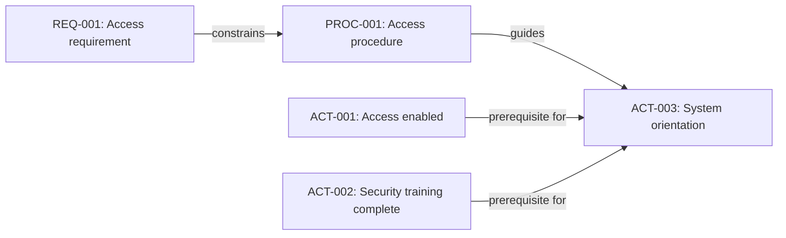

# Information Architecture and Traceability

Information becomes harder to maintain as a project grows. A single handbook is manageable. A network of procedures, decisions, activities, and checks is not—unless we can identify each item and the relationships between them.

**Information architecture** is the way we divide and connect maintained information. **Traceability** means being able to follow meaningful relationships between those items. Neither requires a specialist modeling tool.

## Choose useful boundaries

In the Onboarding Lab, `access.md`, `equipment.md`, and `contacts.md` hold procedures with different owners. Keeping them separate is useful because the teams can maintain and review them independently. Splitting every sentence into its own file would make the system harder to understand.

Start with three questions: Who maintains this information? When does it change? Where will it be used? Keep information together when it shares ownership and a reason to change; separate it when independent maintenance or reuse matters.

## Give important items stable identities

A filename helps a person locate a document. A stable identifier helps software and people refer to an information object even if its title changes. For example, `PROC-001` may identify the access procedure, while `ACT-003` identifies the operational security-training activity.

Do not confuse the two. **Procedure approval** describes whether instructions have been reviewed. **Activity completion** describes whether an onboarding task has been carried out. An approved procedure does not mean a new employee has system access.

## Connect information with explicit relationships

A simple structured record could refer to a procedure and a prerequisite:

```yaml
id: ACT-003
title: Start system orientation
procedure_id: PROC-001
depends_on:
  - ACT-001
  - ACT-002
```

Here `procedure_id` identifies guidance used by the activity; `depends_on` identifies another operational activity. The two relationships mean different things and should be displayed differently.




*This is a conceptual illustration of the fictional scenario, not a live system.*

## What changes when a source changes?

Suppose the requirement for system access is updated. We can follow relationships to identify the procedure, activities, and checks that **may need review**. A link does not prove that every linked object must change; it identifies candidates for impact assessment.

A simple graph is enough to begin. More complex projects may need stronger types, validation rules, ownership, and a way to detect missing or circular references. Introduce that complexity when it solves a real problem.

## Explore: Change impact

Consider changing the wording of REQ-001. Its link identifies PROC-001 as a candidate for review; the procedure's guidance link then identifies ACT-003. A reviewer decides whether either needs an edit. An automated reference check can establish that an ID exists, not whether the relationship is appropriate.

| Item | Role | Review after the requirement changes |
| --- | --- | --- |
| REQ-001 | Fictional access requirement | Confirm the new meaning |
| PROC-001 | Access procedure | Check whether the instructions still agree |
| ACT-003 | System orientation | Check whether its guidance or prerequisites need adjustment |

ACT-001 means system access, ACT-002 means security training, and ACT-003 means system orientation. These synthetic activities explain the readiness simulation in chapter 7. They are not the requirement/task/test records processed by the Python example.


**Key point:** Good information architecture makes change easier to understand. More files and links do not automatically make a better system.

**Next:** [Chapter 7](07-processing.md) processes these connected sources into useful results.

<!-- interactive: chapter-quiz -->
