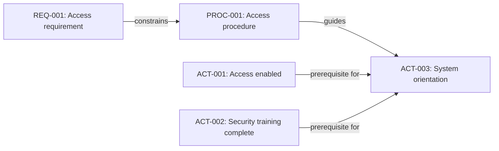

# Information Architecture and Traceability

The security policy changes. Which onboarding procedures should the team inspect, and which activities use those instructions? Searching for a familiar phrase may miss a connection or find an unrelated one.

Explicit identities and relationships give the team a more reliable starting point. **Information architecture** describes how we divide and connect the information; **traceability** lets us follow those connections when something changes.

## Choose useful boundaries

In the Onboarding Lab, `access.md`, `equipment.md`, and `contacts.md` hold procedures with different owners. Keeping them separate is useful because the teams can maintain and review them independently. Splitting every sentence into its own file would make the system harder to understand.

Start with three questions: Who maintains this information? When does it change? Where will it be used? Keep information together when it shares ownership and a reason to change; separate it when independent maintenance or reuse matters.

## Give important items stable identities

A filename helps a person locate a document. A stable identifier helps software and people refer to an information object even if its title changes. For example, `PROC-001` may identify the access procedure, while `ACT-003` identifies the system-orientation activity.

## Connect information with explicit relationships

An activity record can identify both the procedure it uses and the activities it depends on. For example:

```yaml
id: ACT-003
title: Start system orientation
procedure_id: PROC-001
depends_on:
  - ACT-001
  - ACT-002
```

Here `procedure_id` identifies guidance; `depends_on` identifies prerequisite activities. Those relationships answer different questions: which instructions apply, and what needs to happen first?




*In this fictional example, the access requirement constrains the procedure. The procedure guides system orientation, while access and security training are prerequisites.*

## What changes when a source changes?

A policy or requirement change gives us a reason to follow those links. They identify procedures and activities that **may need review**, rather than prescribing an edit to every connected item.

A simple graph is enough to begin. More complex projects may need stronger types, validation rules, ownership, and a way to detect missing or circular references. Introduce that complexity when it solves a real problem.

<!-- interactive: scenario-check-traceability -->

## Explore: Change impact

Consider changing the wording of REQ-001. Its link identifies PROC-001 as a candidate for review; the procedure's guidance link then identifies ACT-003. A reviewer decides whether either needs an edit. An automated reference check can establish that an ID exists, not whether the relationship is appropriate.

| Item | Role | Review after the requirement changes |
| --- | --- | --- |
| REQ-001 | Fictional access requirement | Confirm the new meaning |
| PROC-001 | Access procedure | Check whether the instructions still agree |
| ACT-003 | System orientation | Check whether its guidance or prerequisites need adjustment |

The diagram's activity records are fictional examples of dependencies, separate from the executable requirement/task/test dataset in the [record-processing guide](../reference/record-processing.md).


The useful result is a route from a changed source to the people and information that may be affected. More files and links help only when their boundaries and meanings support that work.

> **Explore further:** How do these relationships become readable diagrams? The [visual-source guide](../reference/visual-sources.md) explains which representations preserve meaning and how to make their outputs accessible. Reading the guide needs no local setup.

Once the records and relationships are clear, software can use them to produce useful results. [Chapter 7](07-processing.md) follows procedure text and metadata into a handbook and review queue.

<!-- interactive: chapter-quiz -->
