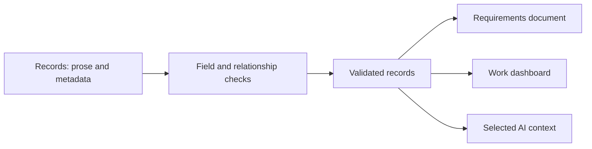

# Processing Information into Views

In chapter 5, we created structured records with identifiers, statuses, and relationships.

Now we can use that information for more than reading.

Imagine having a collection of requirements, tasks, and tests. Instead of manually updating several reports, we can use a program to read the records and produce different views.

**One set of information. Multiple ways to use it.**

In this chapter, we will see how structured records can be validated, connected, and turned into useful outputs.

## From Records to Useful Information

Our fictional onboarding service has four records:

| ID | Type | Status | Description |
|---|---|---|---|
| REQ-014 | Requirement | approved | Confirm access requests |
| REQ-015 | Requirement | proposed | Look up request progress |
| TASK-003 | Task | in-progress | Implement reference numbers |
| TEST-008 | Test | planned | Verify confirmations |

These records contain both readable descriptions and structured metadata. Their approval states belong to the fictional example; they do not establish that the service has been implemented.

We can ask questions such as:

- Which requirements are approved?
- What work is still in progress?
- Which tests are associated with a requirement?

Rather than answering these questions manually, we can use a program to read the records, check their consistency, and select the information needed for each purpose.

This is **information processing**: turning maintained source information into useful results.



*Validate the records before selecting information for each view.*

## Validate Before Using

Before generating any output, we need to check that the records follow the agreed rules.

The [schema introduced in chapter 5](../examples/structured-content/schema.yaml) defines those rules. Our processor applies them and checks relationships between records. It reads this schema and the Markdown files directly inside `examples/structured-content/records/`; it does not validate the chapters in `docs/` or discover schemas automatically.

For example:

| Check | Example |
|---|---|
| Required fields | Every record must have an ID |
| Allowed values | A requirement cannot have status `complete` |
| Unique identifiers | Two records cannot share the same ID |
| Valid references | `verified_by: [TEST-008]` must point to an existing test |

If a check fails, the processor reports an error rather than generating new views.

This prevents some common mistakes from spreading into reports and other outputs.

However, **validation checks consistency, not truth**. A requirement can follow every structural rule and still contain incorrect or ambiguous information.

Human review remains essential. The [processing reference](../reference/record-processing.md#validation-rules) describes the checks and their limits.

## One Dataset, Three Views

Once the records pass validation, the same information can serve different purposes.

Our repository includes a Python program, [`scripts/process_records.py`](https://github.com/And-Gu/document-as-code-lab/blob/main/scripts/process_records.py), that demonstrates this approach.

This is a program written for this tutorial, not a built-in GitHub service. It produces three Markdown files.

Chapter 5's authoring template helps create a source record. An output template arranges selected information for readers. Here, those formatting rules are part of the Python code, not separate template files. Selecting and formatting records does not change their approval status.

### 1. Requirements View

The requirements view collects requirement records and shows their content and status.

For example:

```text
REQ-014: Access Confirmation
Status: approved. Owner: onboarding-team.

The access service must confirm a submitted
request with a reference number.
```

This gives readers a consolidated description of what the system is expected to do.

A proposed requirement can appear in the same document, but its status distinguishes it from an approved requirement.

### 2. Work Overview

The second view summarizes the records by type and status.

| Type | Status | Count |
|---|---|---|
| Requirement | approved | 1 |
| Requirement | proposed | 1 |
| Task | in-progress | 1 |
| Test | planned | 1 |

This provides an overview without manually maintaining a separate status report.

The example is a generated Markdown table, not a live dashboard. Counts describe recorded statuses, not verified progress or test outcomes. [Chapter 10](10-dashboards.md) introduces interactive dashboards and work tracking.

### 3. AI Context

The third view selects information for a particular AI-assisted task.

Suppose we want an AI assistant to draft training material explaining approved system requirements.

The processor can prepare a context file containing only approved requirement records.

In our example, REQ-014 is included, while REQ-015 is excluded because it is still proposed.

This is a useful principle: **give an AI assistant the information relevant to its task, rather than every document in the repository.**

The processor prepares the context file. It does not call an AI service. [Chapter 7](07-ai-native.md) explores how selected information can be used safely and effectively with AI. Approval does not grant permission to share a record with an external service.

## Relationships Between Records

The records also express connections:

| Field | Source | Target | Meaning |
| --- | --- | --- | --- |
| `verified_by` | Requirement | Test | The test is intended to check the requirement |
| `implements` | Task | Requirement | The task is intended to implement the requirement |

For example, TASK-003 implements REQ-014, and REQ-014 refers to TEST-008 for verification. The processor checks that the referenced IDs exist and have the expected types. These links express intended work and verification, not completed work or passing results.

[Chapter 8](08-images.md) shows how these relationships can become diagrams.

## Change the Source, Update the Views

Now imagine that REQ-015 is reviewed and approved.

We change its metadata:

```yaml
status: approved
```

When we run the processor again:

- The requirements view shows REQ-015 as approved.
- The work overview now counts two approved requirements.
- The AI context includes REQ-015.

We changed one source record, but updated three outputs.

There is no need to edit those outputs individually.

This is a central benefit of document-as-code: **maintain the source information and regenerate the views that depend on it.**

The outputs do not update automatically just because a file changes. The processing program must run, either manually or through an automated workflow.

[Chapter 13](13-automation.md) explains how workflows and runners can automate processing. This repository's website checks do not run the record processor; the exercise below runs it explicitly.

## Try It: Update a Requirement

Let's experiment with the actual records in the repository.

You will need a local copy of the repository with Python and its required libraries installed. Follow the [linked environment setup guide](../reference/growth-measurement.md#prepare-a-local-environment) if you have not prepared the environment. Activate that environment before running the commands.

From the repository root, run:

```bash
python scripts/process_records.py
```

The processor creates three files under `build/records/`:

- `requirements.md`
- `dashboard.md`
- `ai-context.md`

Open them and inspect their contents.

Now edit:

[REQ-015](../examples/structured-content/records/REQ-015.md)

Change its status from `proposed` to `approved`. For this exercise, treat the change as a simulated approval rather than a real project decision.

If REQ-015 is already approved in your exercise copy, use another proposed requirement and note its ID. Create one using chapter 5's exercise if necessary.

Run the processor again.

**Check the result:** Does the requirements view reflect the new status? Have the dashboard counts changed? Is REQ-015 now included in the AI context?

Finally, try introducing an invalid status and rerun the processor. Observe the validation error, then restore the correct value.

Remember that files from an earlier successful run may remain after a failed run. They should not be mistaken for newly validated results.

**Expected result:** One source change updates three views, while an invalid status prevents new outputs.

**If the result differs:** Check the starting records, allowed statuses, and the latest terminal message. Compare against your own dataset if it differs from the four supplied records.

**Keep:** Restore deliberate errors and retain a short note about the source change and its effects. Leave generated files under ignored `build/records/`. [Chapter 9](09-git-review.md) covers reviewing and recording source changes.

For input fingerprints, manifests, and further validation experiments, see the [processing reference](../reference/record-processing.md).

## What Comes Next?

We have now seen how structured information can be checked, selected, and reused.

The same principle can support requirements management, project reporting, traceability, publishing, and AI-assisted work.

In [Chapter 7 — AI-Native Documentation and Context](07-ai-native.md), we explore how to provide AI assistants with relevant information, clear instructions, and ways to verify their results.
