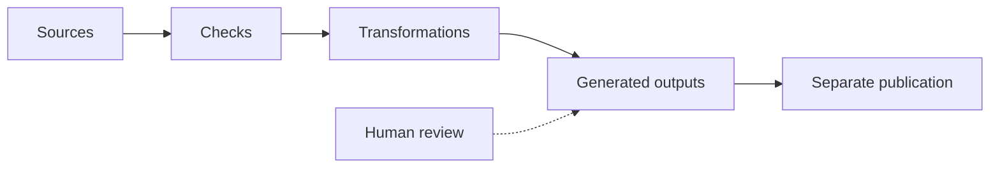

# From Sources to Results

Maintained information becomes more useful when we can transform it into results for different audiences. That requires more than saving Markdown: it requires explicit rules for reading, checking, and assembling sources.

## One processing chain

The Onboarding Lab models procedures and synthetic employee activities. A processor could read them, check fields and references, and produce a handbook, excerpt, and readiness summary. The repository's actual [showcase builder](../scripts/build_onboarding_showcase.py) reads procedure files and generates a handbook review copy, an access-only training excerpt, and review-status data and a chart. It does not calculate employee readiness.

*This is a conceptual illustration of the fictional scenario, not a live system.*

The process contains four distinct steps:

1. **Read sources.** Load procedure text and activity records.
2. **Check rules.** Find missing identifiers, unknown dependencies, or invalid status values.
3. **Transform.** Select, combine, or calculate information for a purpose.
4. **Generate outputs.** Produce readable pages, structured reports, or visualizations.

The same sources can serve several audiences. A handbook uses procedure text; a review queue uses procedure ownership and approval status; a readiness view uses operational activity completion and dependencies. These are different questions and should not share one ambiguous `status` field.

The showcase files use `status` specifically for procedure review. In a combined procedure/activity model, explicit names such as `review_status` and `completion_status` make the distinction clearer. These are modeling choices, not new fields understood automatically by the existing Python processor.

## Processing is not publication

If an instruction changes, the processor can produce an updated handbook. But readers do not automatically receive it. A separate publication step determines what version becomes available and when.

Likewise, a successful build does not mean that the text is accurate or approved. It only shows that the configured tasks completed successfully. Meaning, suitability, and formal acceptance can require human judgment.

## Explore: Run the pipeline

The website simulation starts with the three procedure records. Remove the Contacts owner, then run checks and build. It stops with an error and retains a labelled previous result. Restore the owner, change Contacts from draft to approved, and rerun. Observe the updated **review queue**, not employee readiness. Changing this practice field does not approve the real source.

The separate readiness simulation below changes the employee access task. Orientation responds to that activity, while the procedure text remains unchanged.

<!-- interactive: readiness-lab -->

<!-- interactive: processing-lab -->

## Why this matters

Processing rules are part of the maintained system. They can be versioned, tested, reviewed, and improved alongside the information they transform. This is what makes repeated outputs consistent—and makes the process inspectable when something goes wrong.

## Run the repository processor

The [requirement-record guide](../reference/record-processing.md) retains the runnable REQ-014, task, and test examples. With its Python environment active, run `python scripts/process_records.py` from the repository root. It creates requirements, dashboard, and AI-context Markdown under ignored `build/records/`. It does not process the synthetic ACT records, call an AI service, or publish results.

**Next:** [Chapter 8](08-ai-native.md) explores what AI can do with these maintained sources and clear processing boundaries.

<!-- interactive: chapter-quiz -->
