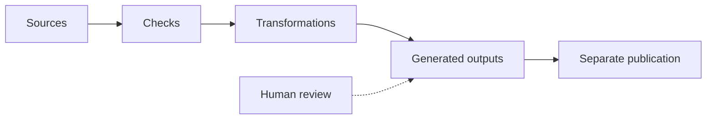

# From Sources to Results

Maintained information becomes more useful when we can transform it into results for different audiences. That requires more than saving Markdown: it requires explicit rules for reading, checking, and assembling sources.

## One processing chain

We will follow the three onboarding procedures introduced in earlier chapters. A small program reads those files and generates a handbook review copy, an access-only training excerpt, and a review-status chart. The repository contains the processing code alongside the source information.

*Sources pass through configured checks and transformations before the results are published.*

The process contains four distinct steps:

1. **Read sources.** Load procedure text and metadata.
2. **Check rules.** Apply the configured validation rules. As introduced in [chapter 5](05-structured-content.md), a schema can define required fields and allowed values. Additional checks can detect duplicate identifiers or references to missing records.
3. **Transform.** Select, combine, or calculate information for a purpose.
4. **Generate outputs.** Produce readable pages, structured reports, or visualizations.

The same sources can serve several audiences. A handbook combines procedure text; a training excerpt selects instructions for a particular session; a review queue uses ownership and review status to identify procedures needing attention.

In these procedure files, `status` records whether the instructions are draft or approved. The processing rules use that meaning when selecting procedures for the review queue. Field names, allowed values, and the rules that interpret them need to agree; renaming a field also requires updating the schema and processing code that use it.

## Processing is not publication

If an instruction changes, the processor can produce an updated handbook. Readers do not necessarily receive that update automatically: publication depends on how the Document-as-Code system is configured. One setup may publish after checks and review; another may require someone to release the result. The setup determines which version readers can access and when it becomes available.

Likewise, a successful build does not mean that the text is accurate or approved. It only shows that the configured tasks completed successfully. Meaning, suitability, and formal acceptance can require human judgment.

## Explore: Run the pipeline

The website simulation builds on the Markdown editor from chapters 4 and 5. You can edit the Contacts procedure's text and metadata; Access and Equipment remain fixed. The rendered preview updates as you type, while the generated handbook text and review queue wait for a successful build.

1. Delete the `owner` line from the Contacts metadata, then select **Run checks and build**. Schema validation fails, so no new output is generated. The last successful result remains visible.
2. Restore `owner: people-team`, edit a sentence in the procedure text, and run again. Find your revision in the **Handbook review copy**. Contacts remains in the review queue because its status is `draft`.
3. Change `status: draft` to `status: approved` and run again. Contacts disappears from the review queue because the selection rule includes only drafts.

You can also try `status: unknown` to trigger a schema error, or change the identifier to `PROC-001` to trigger a duplicate-ID error across the three files. Use **Restore the original example** to reset the editor, then run the build to restore its outputs.

Unlike chapter 5's single-file validation, this build processes all three procedures together. The handbook review copy includes their text, including drafts; the review queue lists only draft procedures. A text edit changes the handbook, while a status edit changes the queue. Both outputs follow explicit rules applied to the same sources. Changing the practice copy does not approve the maintained procedure or publish a handbook.

<!-- interactive: processing-lab -->

## Why this matters

Processing rules are part of the maintained system. **They can be versioned, tested, reviewed, and improved alongside the information they transform.** This is what makes repeated outputs consistent—and makes the process inspectable when something goes wrong.

**Next:** [Chapter 8](08-ai-native.md) explores what AI can do with these maintained sources and clear processing boundaries.

<!-- interactive: chapter-quiz -->
