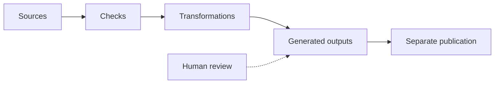

# From Sources to Results

The onboarding team needs a handbook for review, a trainer needs only the access instructions, and procedure owners need a list of drafts. All three can start from the same procedure files, but each needs different selection and presentation rules.

## One processing chain

A small program reads Access, Equipment, and Contacts, checks their fields, then creates those outputs. The fixed showcase produces a handbook review copy, an access-only training excerpt, and a review-status chart. The browser lab below uses the same pattern to produce handbook text and a review queue. The repository holds the processing code alongside the source information.

*Sources pass through configured checks and transformations before the results are published.*

The process contains four distinct steps:

1. **Read sources.** Load procedure text and metadata.
2. **Check rules.** Apply the configured validation rules. As introduced in [chapter 5](05-structured-content.md), a schema can define required fields and allowed values. Additional checks can detect duplicate identifiers or references to missing records.
3. **Transform.** Select, combine, or calculate information for a purpose.
4. **Generate outputs.** Produce readable pages, structured reports, or visualizations.

These rules determine what changes in each result. Editing an instruction changes the assembled handbook; changing its review status can change the review queue without changing the instruction itself.

In these procedure files, `status` records whether the instructions are draft or approved. The processing rules use that meaning when selecting procedures for the review queue. Field names, allowed values, and the rules that interpret them need to agree; renaming a field also requires updating the schema and processing code that use it.

## Processing is not publication

If an instruction changes, the processor can produce an updated handbook. Readers do not necessarily receive that update automatically: publication depends on how the Document-as-Code system is configured. One setup may publish after checks and review; another may require someone to release the result. The setup determines which version readers can access and when it becomes available.

A successful build confirms that the configured tasks completed. A reviewer still decides whether the resulting text is accurate and suitable for release.

## Explore: Run the pipeline

The website simulation builds on the Markdown editor from chapters 4 and 5. You can edit the Contacts procedure's text and metadata; Access and Equipment remain fixed. The rendered preview updates as you type, while the generated handbook text and review queue wait for a successful build.

1. Delete the `owner` line from the Contacts metadata, then select **Run checks and build**. Schema validation fails, so no new output is generated. The last successful result remains visible.
2. Restore `owner: people-team`, edit a sentence in the procedure text, and run again. Find your revision in the **Handbook review copy**. Contacts remains in the review queue because its status is `draft`.
3. Change `status: draft` to `status: approved` and run again. Contacts disappears from the review queue because the selection rule includes only drafts.

You can also try `status: unknown` to trigger a schema error, or change the identifier to `PROC-001` to trigger a duplicate-ID error across the three files. Use **Restore the original example** to reset the editor, then run the build to restore its outputs.

Unlike chapter 5's single-file check, this build processes all three procedures together. It includes all their text in a handbook review copy and selects drafts for the queue. The practice copy stays in your browser; its status changes do not approve the original procedure or publish a handbook.

<!-- interactive: processing-lab -->

The onboarding sources are already prepared for one process. In everyday work, the harder step may be connecting facts maintained in different places. The [Information Refinement Lab](../reference/information-refinement.md) follows one delivery across a customer schedule, planning extract, resources, budget and meeting note, while keeping their meanings separate.

The preview follows your typing; generated results wait for checks and a successful build. That separation helps you see which action produced each result.

> **Explore further:** Want to run the actual record processor? The [record-processing guide](../reference/record-processing.md) covers selected inputs, validation failures, and generated results. It is an optional local exercise requiring a checkout, Python, and the listed dependencies.

## Why this matters

Processing rules are part of the maintained system. **They can be versioned, tested, reviewed, and improved alongside the information they transform.** This is what makes repeated outputs consistent—and makes the process inspectable when something goes wrong.

Those same sources and rules can also guide an AI agent helping with a change. [Chapter 8](08-ai-native.md) turns from our fictional onboarding records to the actual project knowledge an agent needs.

<!-- interactive: chapter-quiz -->
