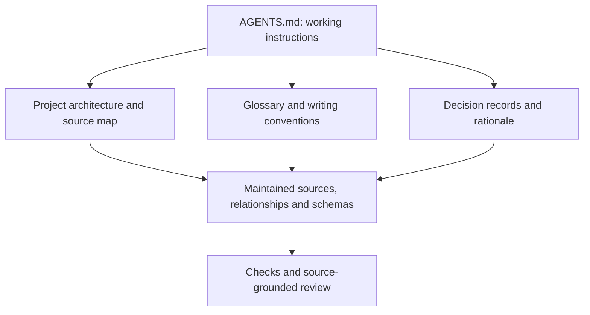

# Making Information Usable by AI Agents

We have organized information into identifiable sources (chapters 4–6) and used processing rules to produce results (chapter 7). The same groundwork helps AI agents work with a project. **What matters is not just supplying more text to a model, but making maintained information discoverable, interpretable and safe to change.**

An agent is an AI-powered tool that can use permitted operations such as reading files, editing sources and running checks. File access alone does not tell it which documents govern the project, why conventions exist, or whether it may publish a result.

## Start with an entry point, not a giant prompt

This repository has an actual [`AGENTS.md`](../AGENTS.md) file. It tells working agents where the maintained chapters live, which paths Astro reads, how chapter IDs are preserved, what related information may need checking, and which commands verify changes.

`AGENTS.md` is a **working-instructions entry point**. It should stay concise and lead to the maintained knowledge needed for the task. Different agent products have different instructions and file-discovery conventions; simply placing a file in a repository does not guarantee that every agent reads it.

## What knowledge should a project maintain?

| Kind of information | The question it answers | Example in this lab |
| --- | --- | --- |
| **Information architecture** | What objects, sources and relationships exist? | [Project source map](../reference/project-knowledge.md): chapters, guides, records and rendering |
| **Language and terminology** | What do our terms mean, and how should we write? | [`GLOSSARY.md`](../GLOSSARY.md) and [`CONTRIBUTING.md`](../CONTRIBUTING.md) |
| **Decisions and rationale** | Why did we choose this structure; what was rejected or superseded? | [Tutorial design decisions](../spec/tutorial/04-DESIGN-DECISIONS.md) |
| **Authoritative content** | What current material can substantiate a claim? | Markdown sources, metadata and schemas |
| **Checks and boundaries** | What can be verified, and who decides whether to accept it? | Tests, build rules, review and publication conventions |

A decision record might explain why this site keeps chapter sources in `docs/` rather than duplicating them inside Astro. The project structure describes *what exists*; the decision explains *why*. An agent's instructions tell it **where to find and apply both**. Decision records must reflect real choices, not be invented afterward as if approved historically.

> **Source note:** The diagram maps routes through project knowledge. Linked files are read when needed; they are not automatically loaded into a model.

## Keep source authority and permissions clear

A proposed requirement is not an approved requirement. A generated handbook is not its authoritative source. A passing build is not approval. These distinctions matter to an agent as much as to a human contributor.

An agent still needs to select relevant current files, identify source revisions, follow permitted relationships, and report what it changed or could not verify. Confidential material must remain within its permitted environment. Nothing in `AGENTS.md` grants permissions that the surrounding tools or organization have not provided.

## Explore: Where should a project rule live?

Where would you maintain a stable-identifier rule and the explanation of why it exists?

<!-- interactive: scenario-check-agent-knowledge -->

> **Explore further:** The [agent context and project-knowledge guide](../reference/ai-context-and-agents.md) examines this repository's guidance, source selection, decision records, permissions and verification in greater detail. No AI account is needed to read it; its optional local examples require suitable tooling.

**Key point:** A project becomes more useful to AI agents when its architecture, terminology, decisions, authoritative sources, and checks are maintained as accessible, connected information—not hidden in one person's prompt.

**Next:** [Chapter 9](09-images.md) shows how people can explore the same structured information through different views.

<!-- interactive: chapter-quiz -->
