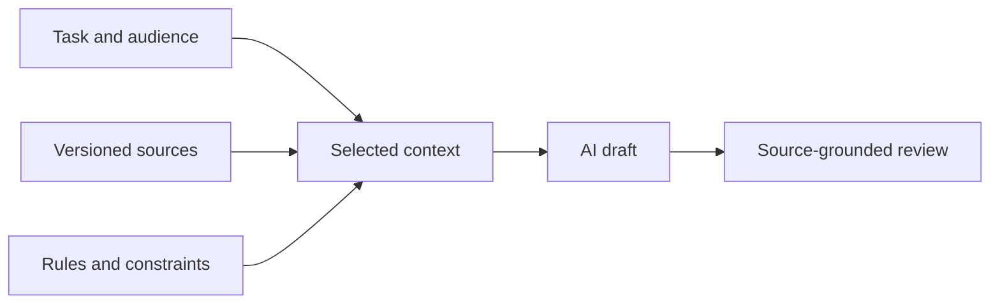

# AI Needs Context, Not Just Prompts

AI assistants can draft text quickly. The harder task is giving them the right information, a clear objective, and a way to check the result.

Document-as-Code offers a useful foundation: maintained sources, known revisions, explicit relationships, and rules that other tools can inspect. These help an AI assistant work with a project rather than guess from a single prompt.

## From a request to a context package

Consider this request: *Write an onboarding briefing for new employees.* An assistant without access to your procedures might invent steps or use outdated guidance.

A better task package contains:

- **Task:** Produce a five-minute briefing about requesting access and collecting equipment.
- **Audience:** New employees, with no internal system knowledge.
- **Sources:** The current `access.md` and `equipment.md` procedures.
- **Constraints:** No invented portal names; cite source sections; flag missing details.
- **Review rule:** A human checks the output against the procedures before use.

*This is a conceptual illustration of the fictional scenario, not a live system.*

A package is not a magic prompt format. It is simply the information needed to complete and assess a task.

## Select, don't dump

More context is not always better. Irrelevant or contradictory files can obscure what the assistant should do. Choose sources by task and authority, and identify which revision is being used.

Separate three things: the source content, the instructions for the assistant, and the generated result. Keep generated drafts distinct until they have been reviewed.

## Let AI propose changes, not silently approve them

An agent may update a procedure, adjust a validation rule, and propose a diagram. This is powerful because it can work across the maintained system. It is also risky: a technically successful change may alter meaning, omit context, or affect several downstream outputs.

Ask agents for small reviewable changes. Inspect the diff, run appropriate checks, and use human review where the content matters. AI-generated text does not become trustworthy simply because it came from versioned sources.

## Explore: Build the context

Compare these prewritten examples for the request above. They are illustrative text, not live AI responses.

| Context | Sample draft | What a reviewer should notice |
| --- | --- | --- |
| No procedures | “Your access will be ready on your first day.” | This promise has no supplied evidence |
| Selected access procedure | “Submit a request and retain its reference number.” | Check the statement against the source before use |

The second draft is easier to check; relevant context does not guarantee that a real model will produce it.

## Continue with the working example

The [AI context and agent guide](../reference/ai-context-and-agents.md) retains context selection, RAG comparisons, confidentiality boundaries, and the trainer exercise. It uses the [requirement processor](../scripts/process_records.py), not the synthetic activity model. The [repository instructions](../AGENTS.md) are an example of project-specific guidance for agents.

**Key point:** AI-native work depends on managed information and verifiable changes, not just better wording in a prompt.

**Next:** [Chapter 9](09-images.md) explores reusable representations and visualizations beyond conventional documents.

<!-- interactive: chapter-quiz -->
