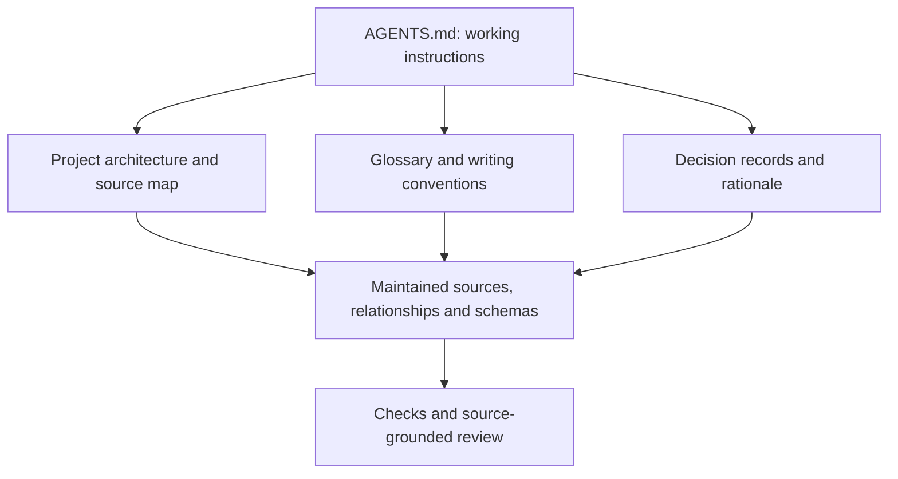

# Making Information Usable by AI Agents

An agent updating this tutorial needs more than access to its files. It needs to know where the chapters live, which terms we use, and which decisions its changes must respect.

An **AI agent** combines a language model with tools for operations such as reading files, editing sources, and running checks. A chat prompt describes the task; repository access comes from the configured tools and permissions. The sources and processing rules from earlier chapters provide useful context; the actual repository adds the conventions and rationale needed to work on the project.

An assistant can help rewrite a status report. A tool-enabled agent could also gather permitted sources, compare a forecast with a commitment, identify missing support, and prepare a source-linked draft. That requires the meaning of the fields, suitable tools, and clear limits on what the agent may change. People still decide how to resolve uncertainty and whether to accept a proposal.

Here we inspect the project knowledge that supports such work. This chapter runs no AI model and gives no agent automatic access to business systems.

## Start with an entry point, not a giant prompt

This repository has an actual [`AGENTS.md`](../AGENTS.md) file. It tells working agents where the maintained chapters live, which paths Astro reads, how chapter IDs are preserved, what related information may need checking, and which commands verify changes.

`AGENTS.md` is a **working-instructions entry point**. It should stay concise and lead to the maintained knowledge needed for the task. Different agent products have different instructions and file-discovery conventions; simply placing a file in a repository does not guarantee that every agent reads it.

## What knowledge should a project maintain?

| Kind of information | The question it answers | Example in this lab |
| --- | --- | --- |
| **Information architecture** | What objects, sources and relationships exist? | [Project source map](../reference/project-knowledge.md): chapters, guides, records and rendering |
| **Language and terminology** | What do our terms mean, and how should we write? | [`GLOSSARY.md`](../GLOSSARY.md) and [`CONTRIBUTING.md`](../CONTRIBUTING.md) |
| **Decisions and rationale** | Why did we choose this structure; what was rejected or superseded? | [Tutorial design decisions](../spec/tutorial/04-DESIGN-DECISIONS.md) |
| **Authoritative content** | What current material can substantiate a claim? | Markdown sources, metadata and schemas |
| **Checks and boundaries** | What can be verified, and who decides whether to accept it? | Tests, build rules, review and publication conventions |

The source map describes *what exists*. A decision record explains *why* a choice was made, such as keeping the core tutorial browser-first. Agent instructions point to both. This repository's dated decision register records supplied design direction, including the audience decision on 25 October 2026; it does not reconstruct earlier approvals.

> **Source note:** The diagram maps routes through project knowledge. Linked files are read when needed; they are not automatically loaded into a model.

## Keep source authority and permissions clear

For a chapter update, the agent should read the current source and applicable conventions, then report the files it changed and the checks it ran. Diffs, validation results, and generated pages give reviewers evidence for assessing the result; a passing build alone does not approve its meaning.

Source selection matters too: a proposed requirement cannot support a claim that a feature is implemented. Confidential material must stay within its permitted environment. `AGENTS.md` guides the work but grants no permissions to read, share, or publish information.

## A bounded information task

An agent can help connect selected evidence as well as develop text. In the [Information Refinement Lab’s illustrative agent workflow](../reference/information-refinement.md#agent-workflow), the assignment is to prepare a source-linked briefing about a possible delivery-date change, preserve different date meanings and return questions for review. The replay uses deterministic rules on fictional sources; it does not run an AI model or grant access to business systems.

## Explore: Where should a project rule live?

Where would you maintain a stable-identifier rule and the explanation of why it exists?

<!-- interactive: scenario-check-agent-knowledge -->

> **Explore further:** The [agent context and project-knowledge guide](../reference/ai-context-and-agents.md) examines this repository's guidance, source selection, decision records, permissions and verification in greater detail. No AI account is needed to read it; its optional local examples require suitable tooling.

Organizing project knowledge helps agents find and interpret the material they need. People benefit from that organization too. [Chapter 9](09-images.md) uses a fictional customer-and-contract example to show how readers can follow relationships and ask their own questions.

<!-- interactive: chapter-quiz -->
