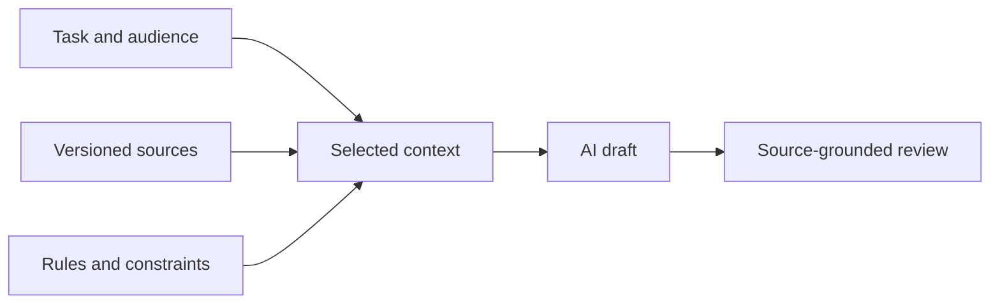

# AI Needs Context, Not Just Prompts

An **AI agent** combines a language model with tools for reading information, proposing changes, and running checks. The usefulness of its results depends on a clear task, relevant sources, and a way to assess what it produces.

Document-as-Code gives agents a familiar working environment: maintained sources, references, version history, and configured checks. With suitable tools and permissions, an agent can use these to work with information as it would with software. The repository organizes the sources; the surrounding environment provides access.

Building that access into everyday work is a step toward **AI-native work**: preparing information and workflows for routine AI use, rather than assembling everything separately for each conversation. Document-as-Code supports this approach without requiring AI or implying that every document is AI-written.

## Combine the request with relevant sources

Consider this request: *Write a short briefing about requesting system access for new employees.* The agent needs the maintained procedure to describe your organization's process accurately.

The **prompt** states what you want the AI to do. **Context** is the information available to help it do that work. For the briefing, we can specify:

- **Task:** Produce a short briefing about requesting system access.
- **Audience:** New employees, with no internal system knowledge.
- **Source:** The maintained [access procedure](../examples/onboarding-showcase/access.md), with its revision identified.
- **Constraints:** No invented portal names; cite source sections; flag missing details.
- **Review rule:** A reviewer checks the briefing against that procedure before use.

*The task determines which sources and rules are supplied to the AI. The resulting draft is then checked against those sources.*

The agent needs to read the procedure itself. You can supply its text or let the agent use Git to retrieve a working copy of the repository, then read the procedure using its file-access tools. Mentioning the procedure's name alone is not enough. For this briefing, the relevant context is the procedure's instructions, conditions, and references, not the whole repository.

## Make coordinated, reviewable changes

An agent can work across related information and processing rules. For example, it can update a procedure, revise an affected explanation, and rebuild the outputs. [Repository instructions](../AGENTS.md) can identify related files and the checks expected for that work.

A change can pass technical checks while altering meaning or omitting important information. The practices introduced earlier help us assess it: diffs show the edits, schemas check structured fields, and builds produce outputs to inspect. Reviewers use this evidence to judge whether the change is suitable.

Keep changes focused enough to review together, and identify anything that has not been checked. Acceptance and publication follow the team's configured process.

## Continue with the working example

The [AI context and agent guide](../reference/ai-context-and-agents.md) offers an optional trainer exercise using records selected by the [requirement processor](../scripts/process_records.py). It also covers confidentiality, source retrieval, and comparing responses with and without supplied context.

**Key point:** Useful AI assistance depends on accessible sources, relevant context, and a workflow that makes the results inspectable.

**Next:** [Chapter 9](09-images.md) explores reusable representations and visualizations beyond conventional documents.

<!-- interactive: chapter-quiz -->
