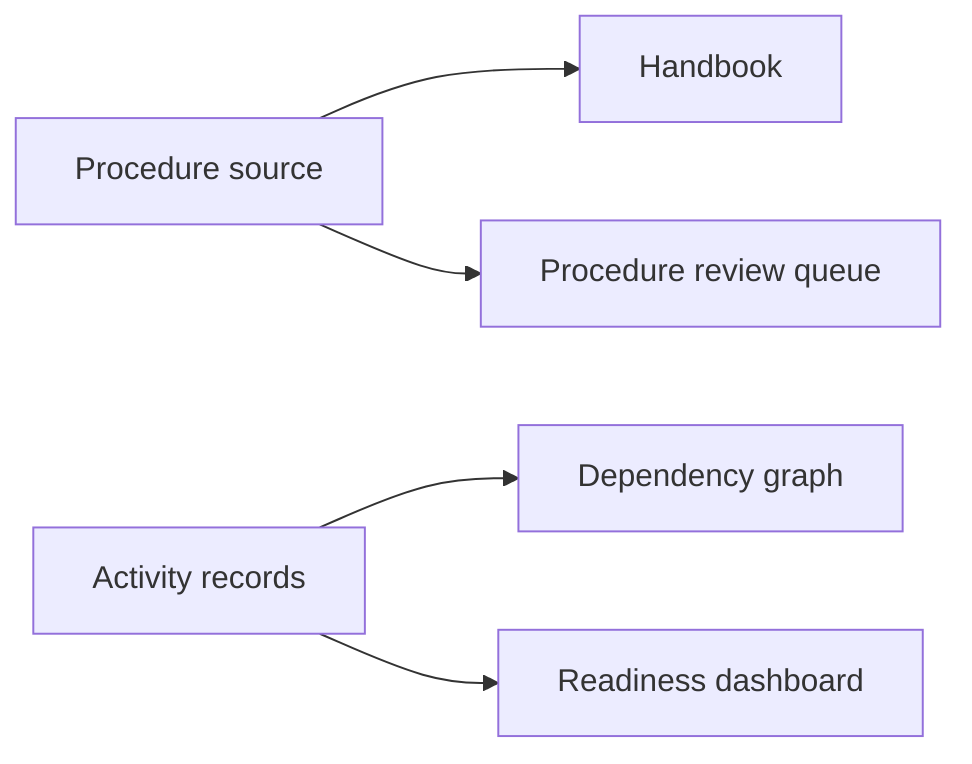

# Beyond Documents: Reusable Information and Visualization

A document is one way to present information. A diagram, model, chart, or dashboard may present the same underlying facts differently. The critical question is whether the **information behind the view** remains available for other uses.

## When your tools keep information inside

Many teams work with presentations, diagrams, specialist models, and visual editors. Some preserve useful data in an accessible format. Others make it difficult to inspect relationships or process information without opening a specific application.

An exported image can show what a model looks like. It rarely tells another tool which objects are connected or what those connections mean. A readable diagram definition or structured model export can preserve more of that information.

This does **not** mean all information must be Markdown or that specialist tools should be replaced. It means selecting a suitable authoritative representation and understanding what is lost when information is exported.

## One source, different views

The Onboarding Lab has procedures, activity records, and dependencies. From those sources, we can prepare:

- A handbook for employees, using procedural instructions.
- A dependency graph for planners, using activity links.
- A readiness dashboard, using operational progress.
- A review queue, using document approval state and ownership.

*This is a conceptual illustration of the fictional scenario, not a live system.*

Each view answers a different question. The dashboard should not be treated as the authoritative source simply because it is easier to read.

## Choosing a representation

Before adopting a file format or tool, ask: Can we identify individual information objects? Can we inspect changes? Can another tool read the relationships? Can we regenerate the result? Who owns the authoritative version?

A closed application can be suitable if it has dependable interfaces or exports. A plain-text file can be unsuitable if important meaning remains implicit. Evaluate the workflow, not the file extension alone.

## Explore: Switch representations

Consider ACT-003, system orientation. A table can list its prerequisites, a graph can show their direction, and a timeline would need dates in addition to those links. Do not invent dates from completion status alone. A screenshot preserves appearance but cannot supply editable activity IDs or relationship fields.

| Activity | Prerequisites | Starting completion state |
| --- | --- | --- |
| ACT-001: system access | None in this example | delayed |
| ACT-002: security training | None in this example | complete |
| ACT-003: system orientation | ACT-001 and ACT-002 | not started; blocked |

A 3D view would add value only if spatial relationships matter. For this onboarding example, a clear 2D dependency graph is better.

## Inspect working visualizations

The [Project Control Center](https://and-gu.github.io/document-as-code-lab/dashboard/) uses actual repository history and published operational snapshots, not the ACT simulation. The [dashboard and spreadsheet guide](../reference/dashboards-and-work-tracking.md#missing-excel-tables-and-spreadsheets) retains the interactive CSSV budget table. The [visual-source guide](../reference/visual-sources.md) covers Mermaid, generated record diagrams, SVG, raster images, and Napkin.

**Key point:** Reuse depends on accessible meaning, not on how attractive the output looks.

**Next:** [Chapter 10](10-git-review.md) examines how teams propose, review, and accept changes to these sources.

<!-- interactive: chapter-quiz -->
