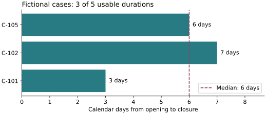

# From Data to Knowledge

A service manager is preparing for a team meeting. The monthly report counts closed customer support cases, but the manager also wants to know **how long customers waited for a resolution**. The case records contain opening and closing dates. How can we turn those dates into an answer the team can use?

In [Chapter 9](09-images.md), we followed connections to find the information needed to answer a question. Once we have found the records, we can investigate what they tell us. Here, we will check five support cases, explain unusual dates and calculate durations. We will then turn the results into a chart and a finding that someone else can check and reuse.

## Start with the case records

Each row below describes one support case. The case ID identifies the record, the team tells us who handled it, and the dates show when it was opened and closed.

| Case | Team | Opened | Closed | Original label |
| --- | --- | --- | --- | --- |
| C-101 | A | 1 Apr | 4 Apr | Login |
| C-102 | A | 2 Apr | 9 Apr | log-in |
| C-103 | B | 3 Apr | — | Access |
| C-104 | B | 7 Apr | 5 Apr | Access issue |
| C-105 | A | 9 Apr | 15 Apr | Equipment |

These dates are all in April 2026. You can inspect the same five records in the [source dataset](../examples/data-enrichment/cases.json).

Before calculating, look at C-103 and C-104. C-103 has no closing date. It may still be open, or the date may be missing from the record. C-104 appears to close two days before it opens. We need to clarify these records before using them to describe resolution time.

This is a **data quality** check: asking whether the information is suitable for the question. For this calculation, we need an opening date and a closing date that is on or after it. Those simple rules tell us which cases we can use and where we need more information.

## Keep the explanation with the record

Suppose a colleague returns to the analysis next month. If the result contains only three cases, how will they know what happened to the other two?

We can attach an **annotation**: a note that explains something about a record. For C-104, a useful note would be:

> The closing date is earlier than the opening date. Check the dates against the original case record. Leave this case out of the duration summary until the dates are confirmed.

For C-103, the note can simply say that the closing date is missing and the duration is unknown. The report keeps all five case IDs, so these questions remain visible alongside the calculated results.

Checking and organising data this way is often called **data curation**. The notes preserve the reasoning behind our choices. If a date is corrected later, a colleague can understand what changed and update the calculation.

## Add useful information

The source gives us two dates for most cases. We can use them to add a new value:

**Resolution duration = closing date − opening date**

Here, duration means elapsed calendar days. A case opened on 1 April and closed on 4 April has a duration of three days. The calculation includes weekends; measuring working hours would require additional information and a different rule.

Adding this calculated value is **data enrichment**. It gives us something useful that was not recorded directly in the source.

| Case | Calculated duration | Use in the summary |
| --- | --- | --- |
| C-101 | 3 days | Include |
| C-102 | 7 days | Include |
| C-103 | Unknown | Wait for a closing date |
| C-104 | −2 days | Check the dates first |
| C-105 | 6 days | Include |

This follows the processing pattern from [Chapter 7](07-processing.md): read the sources, check the fields, apply a rule and produce a result. The [saved analysis](../assets/data-enrichment/analysis.json) contains these durations and the notes explaining which cases were included.

Enrichment can also combine information from different sources. For example, a shared category list could help us group cases labelled “Login” and “log-in” under one service category. The team would first agree on what that category means, then record the mapping so it could be used consistently in later reports.

## Read the chart and check the conclusion

The three usable durations are **3, 7 and 6 calendar days**. In order, they are 3, 6 and 7. The middle value is 6, so we have a **median of 6 days**.

The chart makes the individual cases easy to compare. C-101 took three days; the other two took six and seven. Showing the cases alongside the median helps the manager see the variation behind the summary.

Now return to the question for the team meeting. A useful finding would be:

> Three of the five cases have usable dates. Their resolution times range from three to seven calendar days, with a median of six. We need to clarify the dates for the other two cases before including them.

Review also means checking who and what the finding describes. All three usable durations belong to Team A. Neither Team B case has usable dates, so we **cannot compare team performance** from this result. The manager can use it to begin the discussion and ask for the missing information.

A reviewer can follow each bar back to its case ID, inspect the dates and check the calculation. That connection turns a chart into an explanation people can examine together.

## Give an agent the sources and the question

The context introduced in [Chapter 8](08-ai-native.md) is useful here too. An agent with access to the case records, field definitions and calculation rules can help investigate the manager’s question. A request could be:

> Use these five case records to calculate resolution time in calendar days. Flag missing or reversed dates, keep those cases visible in the report, and chart the usable durations. Draft a short finding that names the cases included and explains what still needs checking.

With suitable tools, the agent can prepare and run the calculation, produce a chart and draft the finding. It can also suggest category mappings or help locate information needed to resolve a gap. The team supplies the business meaning—for example, what counts as a resolved case—and checks proposed corrections against the source.

The benefit comes from working with the same inspectable material. As in [Chapter 9’s knowledge graph](09-images.md#knowledge-map-widget), IDs and source links let the agent follow connections and show where an answer came from. Saving the calculation and notes makes its work available for the next analysis.

## Keep the work useful for the next person

Imagine that the missing closing date arrives a week later. We want to update the analysis without reconstructing how the first chart was made.

<figure class="example-flow">
  <figcaption>What connects the records to the finding</figcaption>
  <ol>
    <li><strong>Original records</strong>Five case IDs, their dates, teams and labels.</li>
    <li><strong>Rules and notes</strong>Check the dates, calculate calendar days and explain which cases to include.</li>
    <li><strong>Reusable results</strong>Durations, a chart and a finding linked to the cases behind them.</li>
  </ol>
</figure>

This example keeps the [source dataset](../examples/data-enrichment/cases.json), [calculation](../scripts/analyze_service_cases.py) and [saved report](../assets/data-enrichment/analysis.json) in the repository. The [example guide](../examples/data-enrichment/README.md) explains how to regenerate the report and chart. A colleague can inspect the work now or use the same method when more records arrive.

The revision history from [Chapter 3](03-project-growth.md) helps explain later changes. If a source date or calculation rule changes, we can compare revisions and see why the result changed. The records, method and explanation together become a useful starting point for further work.

## Take the idea into your work

The same approach can help with inspection results, project estimates or budget figures. Begin with a question, such as which inspections need follow-up or how actual costs compare with estimates. Then identify the records, definitions and calculations needed to answer it.

We have used six practices in the service-case example: **quality checks** found date problems; **annotations** explained them; **enrichment** added durations; **visualization** showed the variation; **review** established what we could conclude; and **preservation** made the work reusable. They support one another. A chart or a reviewer’s question may send us back to investigate a record.

We started with dates and ended with an explained finding. Keeping that connection visible is what makes the result useful beyond one meeting.

> **Take the finding into a presentation.** How could the manager guide the team through the chart, then open the supporting records when someone asks a question? The optional bonus chapter, [Beyond Slides: Presentations as Explorable Knowledge](13-explorable-presentations.md), explores how to combine a guided story, opportunities to explore and a reference people can return to afterward.

In [Chapter 11](10-publishing.md), we look at automation: running established checks and processing rules when their sources change.

<!-- interactive: chapter-quiz -->
