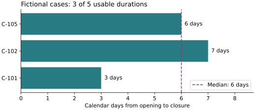

# From Data to Knowledge

A service manager wants to understand how long customer cases take to resolve. The existing report only counts closures. What can a small extract tell us about resolution time, what does it leave unknown, and could someone else check the answer six months later?

The opportunity is not simply to generate a prettier report. We can **improve the underlying data, add meaning, calculate new information, test interpretations, and save the results in a form others can reuse**. These activities are often called *data enrichment* or *data curation*. This chapter approaches them as everyday information work, not as a specialist data-engineering pipeline.

## Six ways to make data more valuable

These are complementary practices, not mandatory steps in a fixed order.

| Practice | Question to ask | Value added |
| --- | --- | --- |
| **Quality** | Are values complete, consistent, current, and plausible for this decision? | More dependable observations |
| **Annotation** | Can we explain what a record means and why it matters? | Context and interpretable labels |
| **Enrichment** | What can we learn by combining data or adding a reference? | Additional attributes and derived values |
| **Visualization** | What becomes visible when we plot and compare the data? | Patterns, gaps, and possible anomalies |
| **Review** | Do the findings stand up to challenge? | Better-qualified conclusions |
| **Preservation and reuse** | Could someone reproduce or extend this work? | Durable data assets and methods |

A plot may reveal an implausible value. A reviewer may ask for a new annotation. An external comparison may show that our definition needs revision. In practice we cycle among the six.

## Start by questioning quality

Consider a fictional extract of support cases:

| Case | Team | Opened | Closed | Original label |
| --- | --- | --- | --- | --- |
| C-101 | A | 1 Apr | 4 Apr | Login |
| C-102 | A | 2 Apr | 9 Apr | log-in |
| C-103 | B | 3 Apr | — | Access |
| C-104 | B | 7 Apr | 5 Apr | Access issue |
| C-105 | A | 9 Apr | 15 Apr | Equipment |

All dates in this example are illustrative and belong to 2026. The [maintained dataset](../examples/data-enrichment/cases.json) preserves these original values. Case C-104 appears to close before it opened. C-103 has no closed date. The three labels *Login*, *log-in*, and *Access* may or may not describe the same problem; a person needs to agree on their meaning before merging categories.

If we simply average durations across these rows, we risk an attractive but misleading number. First record what is missing or suspect. **Do not invent a closing date or silently delete a surprising record**. A reliable dataset can include explicit unknowns and unresolved problems.

Quality depends on intended use. Missing closure dates matter when measuring resolution time, but they might be expected for open cases when studying current workload.

## Annotate what needs explaining

An annotation is additional information attached to a record or result. It could be a category, a human review note, a confidence assessment, a source reference, or a comment explaining an exceptional event.

For example, a reviewer might attach to C-104: *"Close date predates creation; verify original system export. Exclude from duration calculation until resolved."* Keep the observation, the note, and the reviewer’s judgment distinct. If AI suggests a category for a free-text complaint, record it as a **suggested** label until the relevant review occurs.

Annotations are useful far beyond tables. A photograph can carry a marked defect and inspection note. A budget chart can identify the month an accounting rule changed. A document can contain a linked research finding. What matters is that the addition can be interpreted and traced back to its source.

## Enrich by combining and deriving

We could add a maintained reference table mapping validated ticket categories to service families. That would help compare reports, but this extract has no accepted mapping, so we keep its original labels. We can calculate **resolution duration = closed date − opened date** for cases with usable dates. Here we subtract calendar dates, not working hours; these date-only records need no time-zone conversion.

Derived numbers are new data, but they are not automatically new knowledge. A median duration may describe typical completed cases. It cannot, by itself, tell us why cases remain open. Before comparing teams, we might need case complexity, staffing, service type, and changes in process.

External knowledge can contribute too. Compare a finding with a relevant study, standard, or published benchmark. Record the citation, definition, population, and applicability. A published benchmark with a different case definition may not be an appropriate comparison even when the units match.

### An illustrative enrichment record

| Original item | Added value | How obtained | Review state |
| --- | --- | --- | --- |
| C-102 label: log-in | Suggested service family: Identity & Access | Proposed category mapping | Pending review |
| C-101 opened/closed dates | Duration: 3 calendar days | Defined date subtraction | Calculated from example |
| C-104 closed before opened | Suspected date problem | Quality rule | Needs investigation |

A new column without a documented origin is easy to misunderstand. Prefer keeping the derivation rule or reviewer annotation alongside the value.

## Visualize to investigate, not only to present

For our five cases, the usable durations are **3, 7, and 6 calendar days**, with a **median of 6 days**. That describes three cases, not the entire extract. Keep the other two visible:

| Case | Calculated duration | Treatment |
| --- | --- | --- |
| C-101 | 3 days | Include |
| C-102 | 7 days | Include |
| C-103 | Unknown | No closure date; do not invent one |
| C-104 | -2 days | Exclude from the summary; investigate reversed dates |
| C-105 | 6 days | Include |

The plot shows the spread behind the median. Its zero-based axis and individual case labels make the comparison inspectable. A chart of monthly trends would need observations across several months; these five April cases do not supply that evidence.

Choose scales, units, denominators, and exclusions carefully. Visualizations can reveal problems in the dataset as readily as they reveal plausible patterns. Correlation alone does not establish causation.

## Review conclusions and alternatives

Our supported observation is narrow: the three usable durations have a median of six days, and all three belong to Team A. Neither Team B case provides a usable duration. We therefore cannot compare team performance, establish a monthly trend, or conclude that either team became less effective. The next investigation would check the two missing or suspect dates and obtain a broader, comparable sample.

The [saved report](../assets/data-enrichment/analysis.json) retains all five IDs, inclusion decisions, quality annotations, the median, and the source fingerprint. The [example guide](../examples/data-enrichment/README.md) explains how to reproduce it and the plot. This lets a reviewer check the result rather than rely on the prose alone.

Make the review inspectable. Separate **recorded facts**, **derived calculations**, **proposed interpretations**, and **accepted decisions**. A successful data-quality check is not approval of a business conclusion.

## Keep the data worth reusing

Saving a chart alone loses much of the value. Preserve three related kinds of data asset:

1. **Original data:** Unaltered exports or source references, with collection time, origin, and access restrictions.
2. **Curated data:** Quality decisions, normalized fields, annotations, exclusions, and their reasoning.
3. **Derived data:** Calculated metrics, transformations, method versions, and links back to the inputs.

For modest datasets, CSV and JSON can be practical exchange formats; Markdown can document definitions and review decisions. Larger or frequently updated datasets may require a database or other suitable storage. The goal is not to force every dataset into Git: store it where it can be maintained reliably, and version the definitions and transformation rules appropriate to it.

A simple **knowledge catalogue** can list each dataset’s purpose, owner, fields, units, quality, sources, restrictions, relationships, and current revision. The catalogue helps someone discover the asset; it does not replace the asset or prove its quality.

In a team setting, specify who may access, annotate, correct, approve, or redistribute the data. Preserve personal and confidential information only in appropriate, authorized systems. Public learning examples should use fictional or safely anonymized information.

## Where AI can contribute

AI can suggest categories, extract data from reports, draft annotations, propose visualizations, find candidate research, and generate calculation code. These are valuable forms of assistance, especially for large text collections. They also require checks: Was a value extracted correctly? Does a category definition fit? Is the research real and applicable? Can we reproduce the computation without trusting the model’s explanation alone?

A good workflow makes proposed additions visible and allows people to challenge them. The purpose of AI is not to turn every suggestion into an accepted fact.

## Take the idea into your work

Find a dataset you already use: service tickets, a register of decisions, project estimates, inspection results, or a spreadsheet of actuals. Ask three questions. **What quality problems could change the conclusion? What useful context or derived information is missing? What would someone need to reproduce the result later?**

The important change is one of mindset: data are not only inputs for a report. **They are assets we can question, improve, explain, combine, visualize, and preserve for further learning.**

The next chapter looks at automation. Once a transformation or quality check is understood and trusted, we can consider running it repeatably when the relevant source changes.

<!-- interactive: chapter-quiz -->
