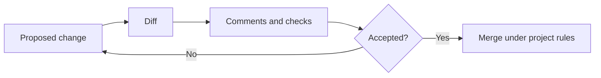

# Reviewing Changes Together

Shared information changes. Teams need a way to propose updates, understand what changed, and decide whether the changes are acceptable.

Git records versions. GitHub adds tools for discussing and reviewing proposed changes. Neither decides whether content is correct.

## Follow a change

Suppose the access procedure needs a clearer instruction. A contributor edits `access.md` on a branch and records a commit. A pull request presents the proposed revision and the differences from the accepted branch.

A reviewer checks the wording, asks for a correction, and confirms that dependent training material still makes sense. After the required review, the team may merge the proposed change.




*This is a conceptual illustration of the fictional scenario, not a live system.*

Three events must stay distinct:

- **Commit:** Records a version; it is not approval.
- **Merge:** Integrates a change into a branch; it does not automatically imply formal authorization.
- **Approval:** A decision under the project's review rules, with whatever evidence the organization requires.

A review may involve subject experts, product owners, security staff, or document owners. The appropriate roles depend on risk and intended use.

## Review the impact, not only the changed lines

A small wording change may affect a training excerpt. A new activity dependency may alter a readiness assessment. Reviewers should inspect the source difference **and** the effects on linked information and generated results.

The relationships introduced in Chapter 6 help identify what to look at; the processing in Chapter 7 helps show what changed downstream.

## Explore: Review a proposal

Compare this fictional proposal:

```diff
- Contact support if access is not ready.
+ Contact support if access is not ready after two days.
```

The added deadline is substantive. A reviewer should ask which agreed service promise supports it rather than accepting it as clearer wording. The handbook and training excerpt would need review if that deadline were accepted. A green build cannot answer this policy question.


For local editing, diffs, approval scope, and a coordinated requirement exercise, use the [practical review guide](../reference/review-and-collaboration.md).

**Key point:** Version control tells us what changed. Review establishes whether a proposed change is acceptable under defined rules.

**Next:** [Chapter 11](11-quality-checks.md) introduces checks that can support—but not replace—that judgment.

<!-- interactive: chapter-quiz -->
