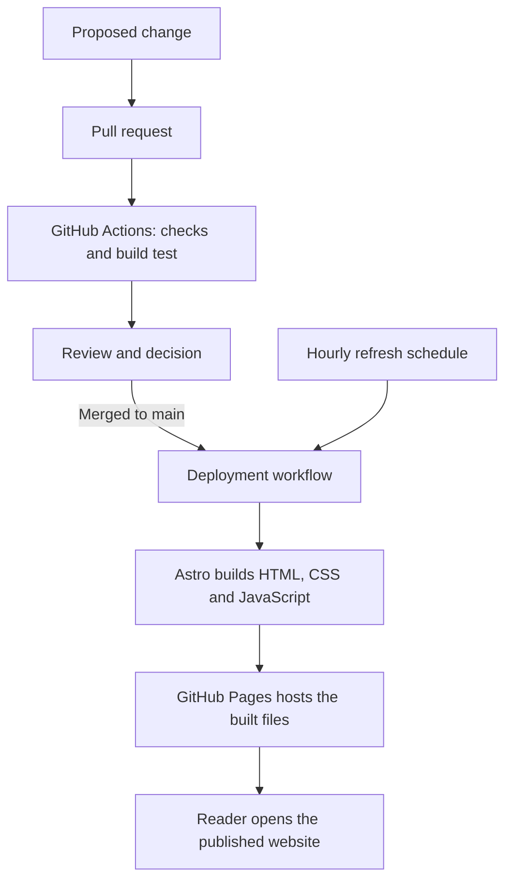

# Automating Information with GitHub Actions

In [Chapter 7](07-processing.md), we ran a program to check information and generate results. But if someone changes a source tomorrow, who will remember to run it again?

**GitHub Actions turns repeatable operations into workflows triggered by events.** This repository uses it to check contributions, measure project growth, prepare a PDF proof, and publish the tutorial website.

## From running a script to running a workflow

A script defines *what to do*. A workflow defines *when to run it, where it runs, and what happens to the result*.

| Term | Meaning |
| --- | --- |
| **Event** | A pull request, push, manual request, or schedule that starts a run |
| **Workflow** | A versioned YAML file in `.github/workflows/` |
| **Job** | Steps that run together, usually on one runner |
| **Runner** | The machine executing a job |
| **Artifact** | An output retained from a run, such as a report or PDF proof |

These are not new kinds of documents. They are a way to run the checks and generators we already maintain, consistently and visibly.

## What runs in this tutorial?

The [repository](https://github.com/And-Gu/document-as-code-lab) contains four workflows with different purposes:

| Workflow | Trigger | Result |
| --- | --- | --- |
| [Astro PR check](../.github/workflows/astro-pr-check.yml) | Pull request targeting `main` | Website, content, learning-component, and dashboard checks; no publication |
| [Deploy Astro to GitHub Pages](../.github/workflows/deploy-pages.yml) | Push to `main`, manual dispatch, or hourly schedule | Builds and publishes the website, including refreshed build-time data |
| [Measure project growth](../.github/workflows/growth.yml) | Push to `main` or manual dispatch | Tests, measured history, and downloadable report artifacts |
| [PDF design proof](../.github/workflows/pdf-proof.yml) | Pull request or manual dispatch | A limited PDF and page images for inspection, not a finished book |

Each has its own purpose and permission boundary. **A passing pull-request check does not publish a website; a downloaded artifact is not a public website.**

## From a change to GitHub Pages

Follow a typical update to this tutorial:



*This is an explanatory flow, not a claim that every merge requires a particular approval rule. Required checks and approvals depend on repository settings. Scheduled runs may be delayed.*

**Astro** builds the site. **GitHub Actions** runs that build and deploys its result. **GitHub Pages** serves the resulting HTML, CSS, JavaScript, images, and data files to readers at:

[and-gu.github.io/document-as-code-lab/](https://and-gu.github.io/document-as-code-lab/)

GitHub Pages is static hosting. It does not run Astro or the project's Python scripts for each visitor. Those operations run before publication; JavaScript in the reader's browser makes quizzes, the Contract Explorer, presentations, and other controls interactive. The dashboard also has an optional, explicitly requested live GitHub API retrieval; most of its data is a published snapshot.

The deployment workflow also runs on an hourly schedule to refresh those snapshots. A site may therefore receive an updated dataset without any chapter text being edited.

## Read the actual deployment definition

Open [`deploy-pages.yml`](../.github/workflows/deploy-pages.yml). Its triggers include:

```yaml
on:
  push:
    branches: [main]
  workflow_dispatch:
  schedule:
    - cron: '17 * * * *'
```

The build job checks out the repository, prepares Python, and invokes the Astro build action. A separate deployment job uses `actions/deploy-pages` to publish the built site. The workflow runs on GitHub-hosted runners; visitors receive its output, not the development environment.

The YAML file is maintained and versioned with the rest of the project. Changing a workflow deserves review too: a faulty build rule can affect every output it produces.

## Explore: Inspect a real run

Open the public [Actions page](https://github.com/And-Gu/document-as-code-lab/actions) and inspect a recent **Deploy Astro to GitHub Pages** run.

1. Find its trigger, source commit, and build/deploy jobs.
2. Check whether the build succeeded and whether the deployment job ran.
3. Open the published site. What kinds of files and interactive experiences can a static host serve?
4. Compare it with a **Measure project growth** run. Where do the downloadable artifacts go, and why are they not automatically part of the website?

**Expected result:** You can trace a published result to a workflow run and source revision, and explain the difference between an Action, an artifact, and GitHub Pages.

A failed build does not establish that a new edition is ready to publish. A successful build establishes only that configured checks passed; it does not approve the meaning of the information. Likewise, a finished job may still need inspection of the actual page.

The [automation and quality reference](../reference/automation-quality.md) covers further checks, runner permissions, failure handling, and stale outputs. [Chapter 11](11-beyond-github.md) brings the entire site architecture together.

**Key point:** GitHub Actions makes information work repeatable. GitHub Pages distributes the finished result. Neither replaces responsibility for the sources and their meaning.

<!-- interactive: chapter-quiz -->
