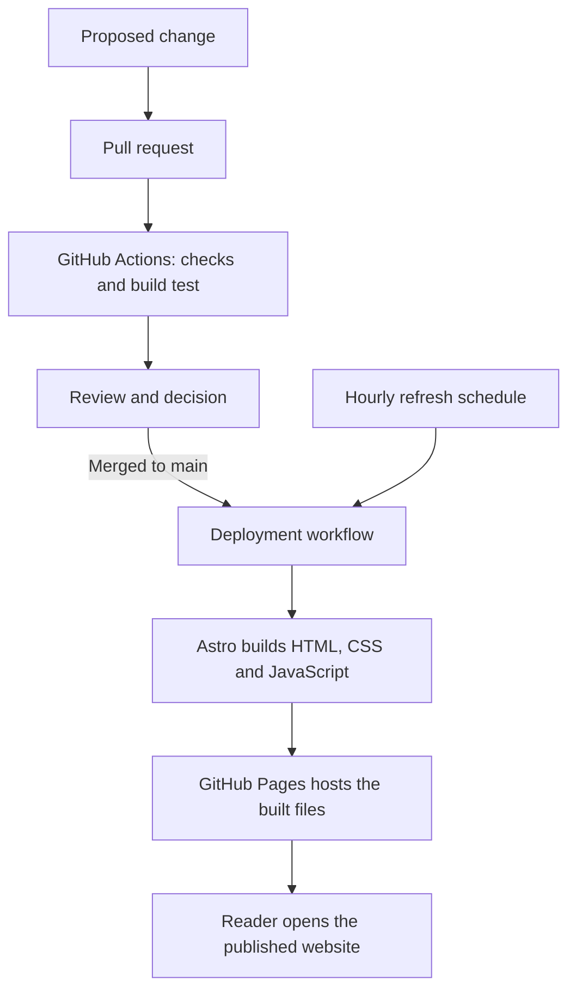

# Automating Information with GitHub Actions

Someone updates a chapter and sends the change for review. The website needs checking before the change is accepted, then rebuilding and publishing after it reaches the shared source. Who will remember to run each operation?

We now turn from fictional examples to this tutorial's actual repository. **GitHub Actions** runs configured operations when events occur, such as a pull request, a push, or a scheduled time. This is how the lab checks contributions, measures growth, prepares a PDF proof, and publishes its website.

## From running a script to running a workflow

A script defines *what to do*. A workflow defines *when to run it, where it runs, and what happens to the result*.

| Term | Meaning |
| --- | --- |
| **Event** | A pull request, push, manual request, or schedule that starts a run |
| **Workflow** | A versioned YAML file in `.github/workflows/` |
| **Job** | Steps that run together, usually on one runner |
| **Runner** | The machine executing a job |
| **Artifact** | An output retained from a run, such as a report or PDF proof |

The workflow file connects an event to the checks and generators introduced in [chapter 7](07-processing.md). Its run record shows what executed and what happened.

## What runs in this tutorial?

The [repository](https://github.com/And-Gu/document-as-code-lab) contains four workflows with different purposes:

| Workflow | Trigger | Result |
| --- | --- | --- |
| [Astro PR check](../.github/workflows/astro-pr-check.yml) | Pull request targeting `main` | Website, content, learning-component, and dashboard checks; no publication |
| [Deploy Astro to GitHub Pages](../.github/workflows/deploy-pages.yml) | Push to `main`, manual dispatch, or hourly schedule | Builds and publishes the website, including refreshed build-time data |
| [Measure project growth](../.github/workflows/growth.yml) | Push to `main` or manual dispatch | Tests, measured history, and downloadable report artifacts |
| [PDF design proof](../.github/workflows/pdf-proof.yml) | Pull request or manual dispatch | A limited PDF and page images for inspection, not a finished book |

Each has its own purpose and permission boundary. **A passing pull-request check does not publish a website; a downloaded artifact is not a public website.**

## From a change to GitHub Pages

Follow a typical update to this tutorial:

*A proposed edit triggers checks; a separate workflow builds and publishes the site after merge or a scheduled refresh. Required approvals depend on repository settings, and scheduled runs may be delayed.*

**Astro** builds the site. **GitHub Actions** runs that build and deploys its result. **GitHub Pages** serves the resulting HTML, CSS, JavaScript, images, and data files to readers at:

[and-gu.github.io/document-as-code-lab/](https://and-gu.github.io/document-as-code-lab/)

GitHub Pages is static hosting. It does not run Astro or the project's Python scripts for each visitor. Those operations run before publication; JavaScript in the reader's browser makes quizzes, the Contract Explorer, presentations, and other controls interactive. The dashboard also has an optional, explicitly requested live GitHub API retrieval; most of its data is a published snapshot.

The deployment workflow also runs on an hourly schedule to refresh those snapshots. A site may therefore receive an updated dataset without any chapter text being edited.

## Read the actual deployment definition

The [deployment definition](../.github/workflows/deploy-pages.yml) records those triggers in YAML. Its build job checks out the repository, prepares Python, and invokes the Astro build action. A separate job publishes the resulting files to GitHub Pages.

The workflow is maintained and versioned with the sources. Changing a build rule deserves review because it can affect every output that uses it. The [publishing guide](../reference/publishing-workflows.md) explains the configuration in more detail.

## Explore: Inspect a real run

Open the public [Actions page](https://github.com/And-Gu/document-as-code-lab/actions) and inspect a recent **Deploy Astro to GitHub Pages** run.

1. Find its trigger, source commit, and build/deploy jobs.
2. Check whether the build succeeded and whether the deployment job ran.
3. Open the published site. What kinds of files and interactive experiences can a static host serve?
4. Compare it with a **Measure project growth** run. Where do the downloadable artifacts go, and why are they not automatically part of the website?

The run connects a source revision to its build and deployment. Inspect the resulting page as well: completing the configured jobs is evidence that the process ran, not approval of the chapter's meaning.

> **Explore further:** What does a runner execute, and what remains after failure? The [automation and quality guide](../reference/automation-quality.md) follows workflow steps, permissions, retained artifacts, and stale outputs. No local setup is needed to inspect the public runs. The [publishing guide](../reference/publishing-workflows.md) covers output-specific build choices.

Actions runs the work; Pages distributes the result. [Chapter 11](11-beyond-github.md) brings those responsibilities together with the sources and browser components to show how the whole lab works.

<!-- interactive: chapter-quiz -->

The verification harness checks a published artifact against its explicit `build-information.json` source revision. A successful local build does not establish that the same revision is live. The [verification register](../spec/tutorial/working-methods-upgrade/verification/README.md) records those results separately from content approval and reader observations.
