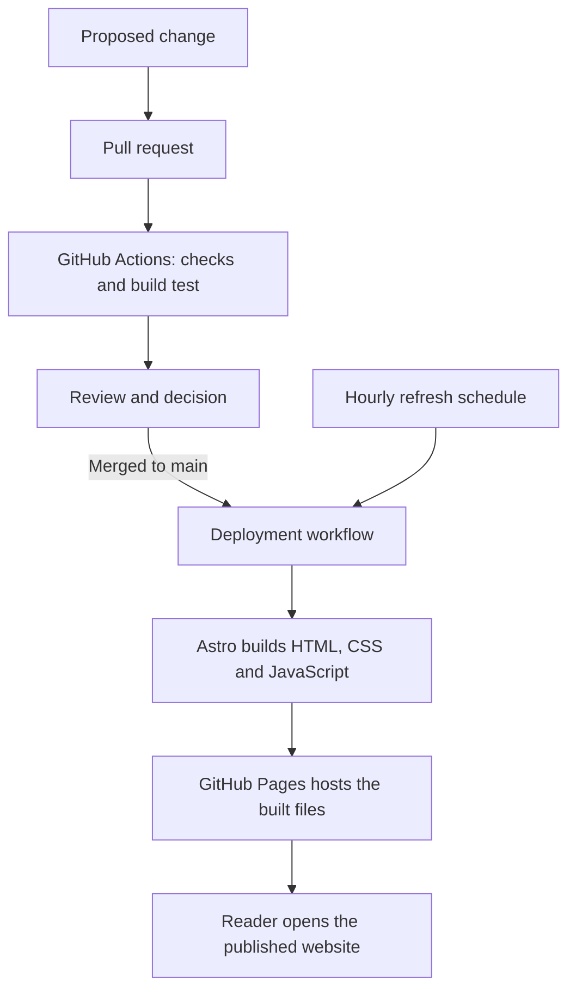

# Automating Information with GitHub Actions

Suppose we improve the explanation of resolution time in Chapter 10. We edit the Markdown, ask a colleague to review it and want the new wording to reach readers. Along the way, the website needs to be checked, rebuilt and published. How can those repeatable tasks happen whenever a change is ready?

In [Chapter 7](07-processing.md), we ran checks and generated results with a button. In [Chapter 10](10-data-enrichment.md), we kept a calculation so it could be run again. **GitHub Actions** lets us connect repeatable work like this to an event, such as proposing a change or merging it. This chapter follows how the tutorial’s own repository uses it to publish a chapter edit.

## Start with a proposed change

The author submits the revised paragraph in a **pull request**, the proposal for review introduced in [Chapter 2](02-github-workspace.md). That event starts the repository’s **Astro PR check**.

The check follows a **workflow**: a set of instructions saved in the repository. It builds the proposed website and runs checks on the result, including links and learning components. If the edit contains a broken chapter link, the check can point it out while the change is still being reviewed.

The reviewer can then consider the wording alongside the check results. The automated work helps answer “Does the site still work?” The reviewer answers “Does this explanation help the reader?”

## From a change to GitHub Pages

Once the change is accepted and merged into the main branch, another workflow builds and publishes the website. Follow the edit through that sequence:

*The proposed edit is checked before review. After merge, the deployment workflow builds the website and publishes the updated files.*

Three tools have distinct jobs in this path:

| Tool | What it does for our chapter edit |
| --- | --- |
| **Astro** | Reads the Markdown and builds the chapter page, its layout and navigation |
| **GitHub Actions** | Runs the configured checks, build and deployment |
| **GitHub Pages** | Hosts the built files so readers can open the updated page |

A **build** prepares the website files. A **deployment** makes those files available on the host. This is the distinction from Chapter 7 in practice: passing the pull-request check prepares a website for inspection; the later deployment updates the public site.

Pages serves the prepared HTML, styles, images, data and JavaScript. When a reader answers a quiz or turns the knowledge graph, JavaScript runs in their browser. The whole website does not need to be rebuilt for each click. During publication, Astro can also reuse unchanged pages through incremental builds. Each deployment still publishes a complete website. The [site build guide](../site/README.md#build-and-publication-performance) explains the cache and its checks.

## Explore: Inspect a real run

Open the public [Actions page](https://github.com/And-Gu/document-as-code-lab/actions), choose **Deploy Astro to GitHub Pages** and open a completed run. A run is one execution of the workflow.

You can view the run summary, source commit and job outcomes without signing in. Reading the [detailed job logs](https://docs.github.com/en/actions/how-tos/monitor-workflows/use-workflow-run-logs) requires a GitHub login; that part of the exercise is optional.

1. **Find what started it.** Look for the event and the source commit. The commit identifies the revision used for this run.
2. **Follow the jobs.** The build job prepares the site; the deploy job publishes it. A further verification job checks the published revision and reader routes.
3. **Optional: inspect the logs.** If you are signed in to GitHub, open a job to read its step-by-step logs. If a step failed, its log helps locate the problem.
4. **Open the [published website](https://and-gu.github.io/document-as-code-lab/).** Compare the relevant page with the change recorded in the source revision.

A **job** groups steps that run on a **runner**, the machine carrying out the work. These names are useful when reading a run: they let you move from the overall result to the operation that produced it.

For our paragraph edit, the chain to inspect is **source revision → build → deployment → published page**. A failure during the build prevents that run from reaching deployment. A failure in the later verification job means the published result needs investigation.

## Read the actual deployment definition

The [deployment workflow](../.github/workflows/deploy-pages.yml) is written in YAML, the structured text format introduced in [Chapter 5](05-structured-content.md). Its opening section lists the events that start it. The jobs below describe the build, deployment and verification.

In this repository, a push to the main branch starts publication. A maintainer can also start it manually, and an hourly schedule refreshes the website’s repository-activity snapshots. That scheduled refresh explains why the Project Control Center can change even when no chapter text has been edited.

The workflow lives beside the chapter sources and has its own revision history. A team can review a change to a publishing rule in the same way it reviews a change to a paragraph.

## Decide where each result belongs

Some automated work produces a file for inspection. The project-growth workflow, for example, saves a report as an **artifact**: a file retained with the run and available to download while it is kept.

That report has a different destination from our chapter page. To become part of the public website, an output must be included in the website build and deployment.

| Work in this repository | When it starts | Where the result goes |
| --- | --- | --- |
| [Astro PR check](../.github/workflows/astro-pr-check.yml) | A pull request | Check results attached to the proposal |
| [Website deployment](../.github/workflows/deploy-pages.yml) | A push to main, a manual request or the hourly schedule | The published GitHub Pages site |
| [Project-growth measurement](../.github/workflows/growth.yml) | A push to main or a manual request | Reports retained with the run |
| [PDF design proof](../.github/workflows/pdf-proof.yml) | Each pull request checks whether PDF inputs are affected; a manual request always renders | A sample PDF and page images when rendering is needed |

## Use the same idea in your work

Return to the service report from Chapter 10. A team could arrange for the agreed date checks and duration calculation to run whenever it receives a new set of case records. The workflow would save the results and identify records needing attention; the manager would use those results to prepare the meeting.

Start by identifying the repeated task, the event that should start it and the destination for its result. Once those are clear, automation can repeat an established method and keep a record of each run.

An agent with access to the workflow and run logs can also help explain a failure or prepare a proposed fix. Keeping the instructions with the sources gives it the context introduced in [Chapter 8](08-ai-native.md).

> **Explore further:** The [automation and quality guide](../reference/automation-quality.md) explains workflow steps and retained results. The [publishing guide](../reference/publishing-workflows.md) covers this repository’s output paths, and [GitHub’s introduction to Actions](https://docs.github.com/en/actions/get-started/understand-github-actions) explains the platform’s terms.

Our chapter edit now has a path from proposal to publication. [Chapter 12](11-beyond-github.md) looks inside that path: which files hold the information, how the website combines them and how the same approach can work in another environment.

<!-- interactive: chapter-quiz -->
