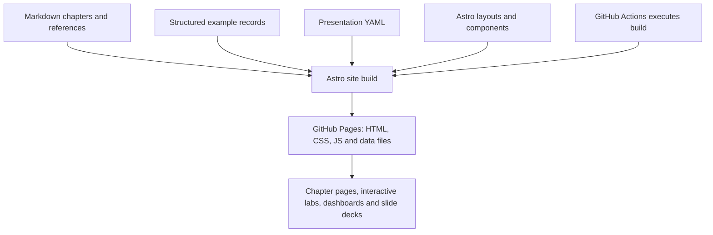

# Behind the Lab: How We Built This Tutorial

You have just used a website built from the information it teaches you to maintain. The chapters live in Markdown, while Astro turns them into pages and combines them with interactive components.

Follow one source through that system, then consider how the same principles could work in a different environment.

## The repository is the workspace

In the [source repository](https://github.com/And-Gu/document-as-code-lab), chapter text lives in `docs/`, fictional records in `examples/`, and presentation definitions in `presentations/`. Astro pages and components live in `site/`; the [source map](../reference/project-knowledge.md) explains the remaining folders.

Astro reads the chapter files directly rather than maintaining a second editable copy of their text. The proposal and review process from [chapter 2](02-github-workspace.md) applies to these sources and to the code that presents them.

## From source files to a public website

*The diagram shows the main publishing path, not every script or optional API request.*

Take DEL-101, the fictional interface-package record from [chapter 9](09-images.md). Its Markdown file contains text and structured fields. During a GitHub Actions build, validation and transformation prepare the explorer data, and Astro assembles the page and browser code. GitHub Pages then serves those built files.

When a reader selects DEL-101, JavaScript in the browser shows its links and details from the built dataset. It does not run the Python tools or an Astro server for that visitor. Updating the source changes the published dataset after a new build and deployment. The record's source link remains the route back to the maintained information.

## From Markdown to interactive experiences

The same separation supports different experiences. Quizzes use maintained question data; playgrounds let readers edit browser-only practice copies. Neither changes the chapter or example sources in GitHub.

Presentations need an additional editorial choice. Their YAML definitions select messages, chapter references, and a teaching sequence; Astro and Reveal.js turn those definitions into slides and speaker notes. A presentation is not simply a chapter projected onto a screen, so changes to its source knowledge still need editorial review.

The dashboard combines measurements from committed history with retrieved GitHub observations. It labels its build-time snapshots and offers a separate opt-in live retrieval. The PDF proof uses another workflow and covers only a limited design trial, not a published book. Their output paths differ, but each needs identifiable inputs and a defined update process.

## Explore: Follow the architecture

Select a chapter page, Contract Explorer, presentation, dashboard, or PDF proof to follow its maintained sources through processing to its result. Each path includes its update trigger and links to the actual source files. The overview table remains readable without JavaScript.

<!-- interactive: architecture-explorer -->

The paths show which work happens before publication and which happens in the browser. To inspect the actual publication step, open the [deployment workflow](../.github/workflows/deploy-pages.yml); the [presentation collection](https://and-gu.github.io/document-as-code-lab/presentations/) shows another result of that same website build.

For a guided overview, open the [Behind the Lab: From Sources to Experience presentation](/document-as-code-lab/presentations/lab-architecture/) or inspect its [YAML source](../presentations/lab-architecture.yaml).

> **Explore further:** Want to reuse the site or slide pattern? The [Astro site guide](../site/README.md) explains source routing and components; the [presentation guide](../presentations/README.md) explains YAML decks and speaker notes. Reading needs no setup; local builds require the tools listed in each guide.

## What would this look like with Microsoft 365?

GitHub is our implementation choice, not a prerequisite for working with maintained, reusable information. A team could use familiar Microsoft 365 tools and still apply many of the same principles.

For example, a team could keep working documents in a managed **SharePoint document library**, or in a shared **OneDrive** location where that arrangement suits the team. Word and Excel provide authoring; file history and library controls support collaboration and review. **Microsoft 365 Copilot** can help people locate, summarize, and compare content they are allowed to access. Configured Copilot agents can use permitted OneDrive and SharePoint files as knowledge sources.

**Reading information is different from changing it.** A Copilot or agent that can answer questions from a document does not automatically have a tool or permission to edit that document. Changes may happen through Office editing, or through suitably configured agent actions, connectors, and flows. Permissions, licensing, and the organization's rules determine what is available.

| Need | This tutorial | A possible Microsoft 365 arrangement |
| --- | --- | --- |
| Maintained sources | Markdown and structured records in GitHub | Word, Excel, and other files in SharePoint/OneDrive |
| Shared history and change review | Git commits, diffs, and PRs | File version history, co-authoring, library review and approval |
| AI access | An agent reads permitted repository files | Copilot or configured agents read permitted files |
| Agent-assisted change | Agent proposes file edits for review | Office editing or authorized file-update tools and flows |
| Automated processing | Python/JavaScript and GitHub Actions | Power Automate, connectors, scripts, or another processing service |
| Reader experience | Astro on GitHub Pages | SharePoint pages, Office outputs, or a separately developed application |

**OneDrive is a file-sharing and storage environment, not a Git repository.** Neither OneDrive nor SharePoint automatically supplies Git-style pull requests or reproducible source builds. The alternatives can support similar *goals*, but the mechanics and capabilities differ. For team-controlled information, a SharePoint library often provides clearer ownership and governance than a personal OneDrive folder.

> **Explore further:** Use a Microsoft environment for a similar information flow: the [portable workflow guide](../reference/workflows-across-tools.md) compares file history, review, Copilot, and automation. Optional hands-on work depends on organizational permissions and licensing.

For product details, see Microsoft's documentation for [Copilot in OneDrive](https://support.microsoft.com/en-us/onedrive/get-started-with-copilot-in-onedrive), [agent knowledge sources](https://learn.microsoft.com/en-us/microsoft-365/copilot/extensibility/knowledge-sources), and the [OneDrive for Business connector](https://learn.microsoft.com/en-us/connectors/onedriveforbusiness/). The tutorial's Microsoft workflow is an illustration, not a validated deployment in an organization.

## Choose the environment for the information

This lab benefits from GitHub and Astro because the sources are structured, changes are inspectable, and we want custom visualizations and repeatable builds. A Microsoft 365-first team might choose different tools because Word, Excel, shared libraries, and Copilot are already part of everyday work.

The deciding question is not *Which product owns the file?* It is **Can people and authorized tools find the maintained information, understand its status, propose changes, and produce trustworthy results?**

## Start with one useful outcome

You do not need to reproduce this entire lab to begin. Choose one recurring need: keeping instructions consistent, finding information awaiting review, or producing a report from shared records.

Identify the sources you are allowed to use, what their fields mean, who maintains and reviews them, and how the result reaches the people who need it. A first experiment might use selected exports from existing systems, with an explicit check that their meaning is preserved. Start with one useful result, then assess whether the approach saves effort or improves decisions before extending it.

The tools may differ from ours. The aim remains the same: maintain the information once, make changes inspectable, and reuse it where it is needed.

The optional [first-increment exercise](../reference/automation-quality.md#plan-a-first-increment) helps you plan that first flow, including responsibility for its processing rules.

<!-- interactive: chapter-quiz -->
