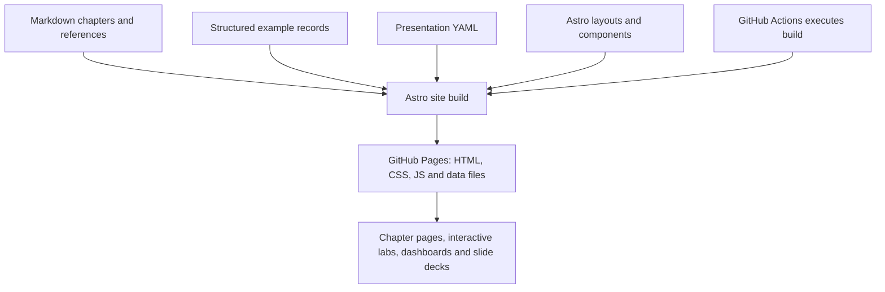

# Behind the Lab: How We Built This Tutorial

This tutorial demonstrates Document-as-Code by using it. The chapters are Markdown files, but the result is a website with interactive exercises, a contract explorer, charts, dashboards, and presentations.

**The central idea is not a particular editor or file type. It is an environment where maintained information can be reviewed, processed, and reused in several experiences.** Here is how we built this one.

## The repository is the workspace

The [source repository](https://github.com/And-Gu/document-as-code-lab) separates information from the software that presents it:

| Location | What it contains |
| --- | --- |
| [`docs/`](../docs/01-introduction.md) | Chapter text and metadata, in Markdown |
| [`reference/`](../reference/visual-sources.md) | In-depth guides beyond the short chapters |
| [`examples/`](../examples/contract-explorer/README.md) | Fictional records and exercise sources |
| [`assets/`](../assets/diagrams/11-lab-architecture.mmd) | Images and diagram source files |
| [`site/`](../site/README.md) | Astro pages, layouts, styles, and interactive components |
| [`presentations/`](../presentations/README.md) | YAML definitions of the HTML slide decks |
| [`.github/workflows/`](../.github/workflows/deploy-pages.yml) | Automated validation, builds, reports, and deployment |

**Git** records revisions. **GitHub** makes the repository accessible to collaborators, supports pull requests (PRs), and runs automated workflows. An author can propose a Markdown edit in a PR; reviewers inspect the difference and relevant checks before the change is merged. Review and merge are not necessarily formal approval of the information.

Astro reads the original chapter files directly. We do not maintain one copy of each chapter in Markdown and another manually edited copy in HTML.

## From source files to a public website

*The diagram shows the main publishing path, not every script or optional API request.*

The technologies have different responsibilities:

- **Markdown** maintains readable content and structured source records.
- **Astro** turns those sources into styled HTML pages and combines them with components.
- **GitHub Actions** runs checks and the site build when its configured events occur.
- **GitHub Pages** hosts the built files at [and-gu.github.io/document-as-code-lab/](https://and-gu.github.io/document-as-code-lab/).
- **Browser JavaScript** provides interaction after a reader opens a page.

This last distinction matters. GitHub Pages does not run Python scripts or an Astro server for every visitor. The build runs before publication. Yet the published site is far from a static reading experience: it can include interactive views, local calculations, filtering, and presentations. Optional browser API calls are possible where explicitly implemented and permitted.

## From Markdown to interactive experiences

The same site combines several forms of information:

| Experience | How it is built | What remains authoritative |
| --- | --- | --- |
| **Chapters and references** | Astro renders Markdown into HTML, navigation, and diagrams | The source Markdown files |
| **Quizzes and playgrounds** | Reusable components are mounted into chapter pages using markers | Chapter sources, component code, and question data |
| **Processing lab** | Browser-only simulation validates a practice copy and generates a review view | The separately maintained source examples |
| **Contract Explorer** | Nine structured Markdown records are validated and transformed at build time; browser code provides three exploratory views | The records in `examples/contract-explorer/` |
| **Project Control Center** | Build-time measurements and published GitHub snapshots feed a browser dashboard | Repository history and the retrieved GitHub observations |
| **Presentations** | YAML selects messages and chapter references; Astro and Reveal.js build HTML slides and notes pages | Chapter knowledge and the maintained deck definitions |
| **PDF proof** | A separate workflow creates a limited PDF for review | Its identified inputs; a full PDF book is not yet published |

A presentation is not just a chapter projected onto a slide. Its YAML file selects a message and a teaching sequence, so editorial review is needed when the underlying information changes. The [presentation collection](https://and-gu.github.io/document-as-code-lab/presentations/) includes multiple decks built with the same website pipeline.

The Contract Explorer makes the distinction especially clear. Its interface can show relationships, delivery commitments, and possible change impacts without storing three independently maintained copies of the contracts. It reads a validated transformation of the underlying records. The user can inspect source IDs and links but cannot silently edit the repository from the browser.

## Explore: Follow the architecture

Select a chapter page, Contract Explorer, presentation, dashboard, or PDF proof to follow its maintained sources through processing to its result. Each path includes its update trigger and links to the actual source files. The overview table remains readable without JavaScript.

<!-- interactive: architecture-explorer -->

You can already inspect the same path manually:

1. Open the [Chapter 9 Contract Explorer](09-images.md), select an item, and follow its source link.
2. Open the [presentation collection](https://and-gu.github.io/document-as-code-lab/presentations/) and look at how a short teaching message refers back to a chapter.
3. Open the [deployment workflow](../.github/workflows/deploy-pages.yml) and identify where the Astro build and GitHub Pages deployment happen.

For a guided overview, open the [Behind the Lab: From Sources to Experience presentation](/document-as-code-lab/presentations/lab-architecture/) or inspect its [YAML source](../presentations/lab-architecture.yaml).

## What would this look like with Microsoft 365?

GitHub is our implementation choice, not a prerequisite for working with maintained, reusable information. A team could use familiar Microsoft 365 tools and still apply many of the same principles.

For example, a team could keep working documents in a managed **SharePoint document library**, or in a shared **OneDrive** location where that arrangement suits the team. Word and Excel provide authoring; file history and library controls support collaboration and review. **Microsoft 365 Copilot** can help people locate, summarize, and compare content they are allowed to access. Configured Copilot agents can use permitted OneDrive and SharePoint files as knowledge sources.

**Reading information is different from changing it.** A Copilot or agent that can answer questions from a document does not automatically have a tool or permission to edit that document. Changes may happen through Office editing, or through suitably configured agent actions, connectors, and flows. Permissions, licensing, and the organization's rules determine what is available.

| Need | This tutorial | A possible Microsoft 365 arrangement |
| --- | --- | --- |
| Maintained sources | Markdown and structured records in GitHub | Word, Excel, and other files in SharePoint/OneDrive |
| Shared history and change review | Git commits, diffs, and PRs | File version history, co-authoring, library review and approval |
| AI access | An agent reads permitted repository files | Copilot or configured agents read permitted files |
| Agent-assisted change | Agent proposes file edits for review | Office editing or authorized file-update tools and flows |
| Automated processing | Python/JavaScript and GitHub Actions | Power Automate, connectors, scripts, or another processing service |
| Reader experience | Astro on GitHub Pages | SharePoint pages, Office outputs, or a separately developed application |

**OneDrive is a file-sharing and storage environment, not a Git repository.** Neither OneDrive nor SharePoint automatically supplies Git-style pull requests or reproducible source builds. The alternatives can support similar *goals*, but the mechanics and capabilities differ. For team-controlled information, a SharePoint library often provides clearer ownership and governance than a personal OneDrive folder.

For more detail, see the [portable workflow reference](../reference/workflows-across-tools.md) and Microsoft's documentation for [Copilot in OneDrive](https://support.microsoft.com/en-us/onedrive/get-started-with-copilot-in-onedrive), [agent knowledge sources](https://learn.microsoft.com/en-us/microsoft-365/copilot/extensibility/knowledge-sources), and the [OneDrive for Business connector](https://learn.microsoft.com/en-us/connectors/onedriveforbusiness/). The tutorial's Microsoft workflow is an illustration, not a validated deployment in an organization.

## Choose the environment for the information

This lab benefits from GitHub and Astro because the sources are structured, changes are inspectable, and we want custom visualizations and repeatable builds. A Microsoft 365-first team might choose different tools because Word, Excel, shared libraries, and Copilot are already part of everyday work.

The deciding question is not *Which product owns the file?* It is **Can people and authorized tools find the maintained information, understand its status, propose changes, and produce trustworthy results?**

**Key point:** This lab combines sources, software, and publishing into one reviewable system. The tools can change; the principles of ownership, accessibility, processing, and traceability do not.

## Start with one useful outcome

Choose one recurring information problem, an accountable owner, and a consumer who needs the result. Build a small, complete path from maintained sources through review and checks to one useful output. Agree who maintains the information, who reviews it, and who maintains the processing rules; these can be different people.

Measure whether the result reduces update effort, catches errors, or helps the consumer make a decision. Extend the workflow when the benefit justifies the maintenance, learning, and support it requires. The [first-increment exercise](../reference/automation-quality.md#plan-a-first-increment) helps you turn that choice into a practical plan.

<!-- interactive: chapter-quiz -->
