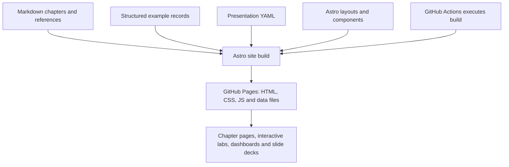

# Behind the Lab: How We Built This Tutorial

A colleague wants to improve a paragraph in this tutorial and asks, “Where should I make the change, and how will it reach the website?” We can answer by tracing the page back to its source.

[Chapter 11](10-publishing.md) followed an edit through checking and publication. Here, we look inside the website that those operations build. The chapters, quizzes, knowledge graph and presentations draw on maintained files in the same repository.

## Find the source of a chapter page

The chapter text lives in a Markdown file in the repository’s `docs/` folder. **Astro**, the tool that builds this website, reads that file and combines it with the page layout, chapter navigation and any interactive components.

To improve the paragraph, we edit the Markdown source. The next website build uses that wording. This is the maintained-source idea from [Chapter 1](01-introduction.md), applied to the tutorial itself.

## Explore: Follow the architecture

Start with **Chapter page** in the explorer below. It traces the automation chapter you have just read.

1. Under **Maintained source**, open the Markdown file and find a paragraph you recognise.
2. Follow **Transformation / runtime** to see how Astro reads the text and prepares the page.
3. Under **Delivered result**, open the chapter page. It presents the same text with navigation and learning controls.
4. Read **Update trigger** to see what causes the website to be rebuilt.

<!-- interactive: architecture-explorer -->

The three columns connect the author’s file to the reader’s experience. If the wording needs work, change the source. If every chapter needs a different layout, change the shared layout code. In each case, the build combines the current sources into a new result.

The [project source map](../reference/project-knowledge.md) shows where the other kinds of information live: example records, concept definitions, questions, presentation outlines and the code that processes them.

## From source files to a public website

A chapter is one path through the larger system. Other maintained sources enter the same website build:

*Astro combines the maintained information with the code that presents it. GitHub Actions runs the build, and GitHub Pages hosts the result.*

The sources and the processing code are kept in the [same repository](https://github.com/And-Gu/document-as-code-lab). A change that affects several files can be proposed and reviewed together using the process from [Chapter 2](02-github-workspace.md). Their shared history helps explain which combination produced an earlier result.

## From Markdown to interactive experiences

Choose **Knowledge graph** in the architecture explorer to trace the map from [Chapter 9](09-images.md). Its [source records](../data/course-concepts.json) contain the concepts, descriptions, named relationships and chapter links. During the build, checks validate those records and the website prepares them for the graph.

When you select **Metadata**, the browser displays its description and connections from that prepared data. The 3D library draws the labels and lines. You can explore the information immediately; a change to a concept’s maintained description reaches readers through a new build and deployment.

This separation also explains the processing lab in [Chapter 7](07-processing.md). The browser receives the example procedures and code for the exercise. It can then process your practice edits and display the results while you work on the page.

Now choose **Presentation** in the architecture explorer. Its source is a YAML outline containing slide messages, speaker notes and chapter references. The website builds a slide deck from that outline. The author chooses a sequence for an audience, while the references connect the presentation to the fuller explanations.

You can see that result in [Behind the Lab: From Sources to Experience](/document-as-code-lab/presentations/lab-architecture/) and compare it with the [presentation source](../presentations/lab-architecture.yaml). When a chapter changes, those references help the author find slides that may need an update. The [bonus chapter](13-explorable-presentations.md) explores how presentations can combine a guided story with interactive exploration.

The remaining explorer tabs show other output paths. **Project Control Center** uses measurements and GitHub observations collected for publication; **PDF design proof** produces a sample document retained with a workflow run. Comparing their sources and update triggers tells us how each result stays current.

> **Explore further:** The [Astro site guide](../site/README.md) explains how sources become pages. The [presentation guide](../presentations/README.md) explains slide outlines and speaker notes.

## What would this look like with Microsoft 365?

Suppose the colleague’s task is to update a staff procedure in a team that already works in Word and SharePoint. The same questions still apply: where is the maintained procedure, who reviews the change and how do readers find the current version?

One possible arrangement is to keep the Word document in a shared SharePoint library. The author updates that document, and colleagues use its version history to inspect earlier wording. The team can configure content approval to control when a revision becomes available to readers. Microsoft describes these controls in its [guide to library versioning](https://support.microsoft.com/en-us/sharepoint/lists/documents-and-library/how-versioning-works-in-lists-and-libraries).

| Question | This tutorial | A possible Microsoft 365 arrangement |
| --- | --- | --- |
| Where is the maintained text? | Markdown in the repository | A Word document in a SharePoint library |
| How do colleagues inspect a change? | Git history and a GitHub pull request | Document version history and a configured review process |
| How does the result reach readers? | An Astro build deployed to GitHub Pages | A shared document or SharePoint page |
| What can an agent use as context? | Relevant repository files and project guidance | Permitted documents configured as knowledge sources |

A configured Copilot agent can use SharePoint and OneDrive content that the user is allowed to access. For the procedure, it could help find related guidance or prepare an answer using that context. Microsoft’s [agent knowledge-source guide](https://learn.microsoft.com/en-us/microsoft-365/copilot/extensibility/knowledge-sources) explains the available sources and access requirements. Editing documents also requires appropriate editing tools and permissions.

The concrete setup differs from this lab, but the purpose is familiar: keep a source people can find, preserve its history and make the reviewed information useful to readers. The [portable workflow guide](../reference/workflows-across-tools.md) explores the comparison in more detail.

## Choose the environment for the information

This tutorial uses GitHub and Astro because we maintain text and structured records together, review changes across files and build custom interactive views. A team working mainly with Office documents may begin with its existing shared library.

For either setting, trace one piece of information from the place it is maintained to the person who uses it. That reveals the connections the team already has and the repeated work it could improve.

An agent benefits from that same map. Given the source locations, field definitions and processing rules, it can help locate the right material, identify related edits and prepare a change for review.

## Start with one useful outcome

Choose a recurring need in your work, such as keeping a staff guide and training material consistent. Find the instruction they share and identify where it should be maintained.

Then sketch its path: **maintained instruction → review and processing → the two reading experiences**. Name the person responsible for the source and the event that should update each result. This is enough to begin discussing a small, useful experiment.

The optional [first-increment exercise](../reference/automation-quality.md#plan-a-first-increment) helps you describe that flow. The [Information Refinement Lab](../reference/information-refinement.md) offers another example of turning selected sources into an explained draft.

We have now followed the information through the whole lab, from an editable source to something a reader can use.

<!-- interactive: chapter-quiz -->

[Bringing It Together](13-course-summary.md) returns to the four parts of the course and connects what each one added.
