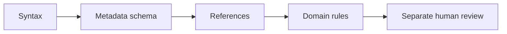

# Quality Checks You Can Run

A repeatable check can find errors early. It can verify missing fields, broken references, unsupported status values, and whether an output can be built. It cannot, by itself, establish that a procedure is safe, current, or appropriate.

## Start with visible failure modes

In the Onboarding Lab, a useful set of checks might verify that every procedure has a unique identifier, an owner, and an allowed review status; that every activity dependency refers to an existing activity; and that no dependency cycle prevents meaningful ordering.

*This is a conceptual illustration of the fictional scenario, not a live system.*

Checks answer different questions:

| Check | Example | What it does not prove |
| --- | --- | --- |
| Syntax | Valid YAML fields | Correct meaning |
| Schema | Required `owner` present | Owner is the right person |
| References | `ACT-001` exists | Dependency is appropriate |
| Domain rule | No dependency cycles | Plan is feasible |
| Build | Website renders | Information is approved |

Treat a failed check as a diagnostic result, not merely a red icon. It should say what failed, where, and how the author can investigate.

## Checks should change with the project

New requirements may justify new validation rules. A check that is useful for ten procedures may become essential for a thousand. But unnecessary rules increase maintenance cost and may encourage teams to satisfy the rule without improving the information.

Version checks and test cases alongside processing logic, and review updates to them as carefully as changes to the content.

## Explore: Find and fix errors

The website demonstration below checks procedure fields. Remove Contacts owner and run it; restore the owner and rerun. A passing result still does not approve the procedure.

<!-- interactive: metadata-lab -->

Activity validation would need additional rules. These are worked cases, not checks implemented by the procedure simulator:

| Input | Defined rule | Expected diagnostic |
| --- | --- | --- |
| PROC-003 has no owner | Owner is required | PROC-003: owner is required |
| ACT-003 depends on ACT-999 | Dependency IDs must resolve | ACT-003: unknown dependency ACT-999 |
| ACT-001 depends on ACT-003, which depends on ACT-001 | Dependencies must be acyclic | Cycle: ACT-001 → ACT-003 → ACT-001 |

The Python requirement validator checks required fields and typed references, but does not implement this activity model or its cycle rule.

The [automation and quality guide](../reference/automation-quality.md) retains workflow/runner explanations, existing workflow boundaries, output hashes, and the stale-output experiment. The [record guide](../reference/record-processing.md#validation-rules) documents the implemented Python checks.

**Key point:** Automation improves consistency by checking defined properties. Responsibility for information quality remains with people and their processes.

**Next:** [Chapter 12](12-publishing.md) shows how checked sources become published outputs.

<!-- interactive: chapter-quiz -->
