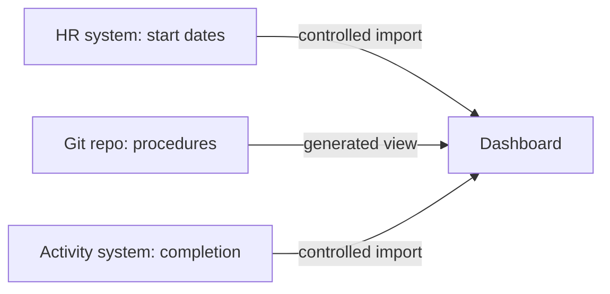

# Working Across Tools

Document-as-Code rarely begins with an empty workspace. Teams already use documents, spreadsheets, project management systems, engineering tools, and databases. The goal is to connect information deliberately, not replace everything.

## Decide where information is maintained

Suppose employee start dates are authoritative in an HR system while onboarding procedures are maintained as Markdown. A dashboard may combine both. That does not make the dashboard the source of either dataset.

Identify the **system of record** for each information type, who can update it, and how changes flow to consumers. Use the term *source of truth* carefully: different kinds of information can have different authoritative systems.

*This is a conceptual illustration of the fictional scenario, not a live system.*

## Common integration choices

- **Reference:** Link to information maintained elsewhere.
- **Import:** Copy data into a controlled processing workflow, with a known update cadence.
- **Export:** Produce a file or interface for another application.
- **Synchronize:** Exchange changes under defined ownership and conflict rules.

Each has trade-offs. Imports can become stale. Exports may lose relationships. Two-way synchronization can create conflicts if both sides can edit the same field.

## Choose a toolchain around the authoritative source

Different information can remain in different tools. Choose where each kind is maintained before deciding how to connect it.

| Arrangement | A suitable use | What to make explicit |
| --- | --- | --- |
| Repository with readable sources | Procedures, metadata, and shared processing rules. | Ownership, review evidence, and publishing rules. |
| Document library or cloud folder | Teams primarily maintain Word files, spreadsheets, or presentations. | Which copy is authoritative, who can edit it, and how revisions are identified. |
| Engineering model or business system | Domain-specific relationships and controlled records already have a maintained home. | Stable references, permitted exports, and the meaning preserved by each interface. |
| Hybrid workflow | A report combines sources maintained in several systems. | Import times, provenance, conflict rules, and responsibility for failed updates. |

For example, keep a procedure in its maintained source and import a permitted HR value for a report. Do not create a second editable master merely to put everything in one repository. A link or one-way import is often enough; two-way synchronization needs a clear reason and conflict handling.

## Protect meaning and access

An accessible format is not automatically a permitted format. Confidential records, personal data, regulated information, and external-system credentials may require stricter handling. Examples in this tutorial are fictional; do not put real employee data or restricted information in a public repository.

AI assistants and build agents should receive only the information and permissions needed for their task. Include provenance and classification where relevant.

## Explore: Source-of-truth decisions

For this fictional integration, keep start dates in HR, procedures in the repository, and task completion in an activity system. A dashboard reads all three.

If HR says Monday and a downloaded spreadsheet says Tuesday, the spreadsheet should not silently overwrite HR. A one-way import follows the authoritative value on the next refresh. Two-way editing needs explicit conflict and review rules before either value is written back.

The [portable workflow guide](../reference/workflows-across-tools.md) retains the OneDrive, Word, and Copilot exercise, access boundaries, and manual registers. Those Microsoft-environment exercises remain unverified in a real account. The tutorial does not synchronize an HR or activity system.

**Key point:** Good integration preserves ownership, provenance, and meaning across tool boundaries.

**Next:** [Chapter 13](13-automation.md) turns the principles into a realistic adoption plan.

<!-- interactive: chapter-quiz -->
