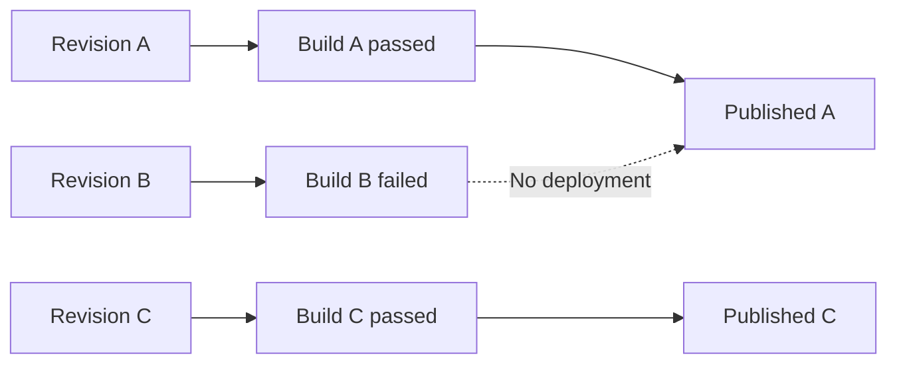

# From Build to Publication

Maintained information and published information are not always the same version. A source file can change today while a website or PDF still reflects yesterday's successful publication.

## Separate the stages

The Document-as-Code Lab website provides a useful example. The project maintains Markdown sources in GitHub. Astro builds web pages from those sources. GitHub Pages serves the deployed website. A PDF edition would need its own build and release process.

*This is a conceptual illustration of the fictional scenario, not a live system.*

Think in four steps:

1. **Change:** A contributor records new source information.
2. **Check and build:** Configured tasks validate and generate outputs.
3. **Release decision:** The team selects which result should be distributed.
4. **Publish:** A website, package, or document edition becomes available to readers.

Some projects automate all four steps after a merge. Others require explicit approval before release. The correct choice depends on the information and the risks of publishing it.

## A failed build should not silently change the publication

Suppose revision B introduces an invalid reference. If the build fails, the published site should remain on its last successful release, revision A. After the error is fixed and a new build passes, the deployment can move forward.

This distinction is essential for auditability: when someone reads a page, we should be able to determine which source revision produced it.

## Different outputs, different schedules

The same sources may feed a frequently updated internal dashboard and a PDF handbook released quarterly. Maintaining one source does not force every output to update at the same moment. Each delivery process needs explicit triggers, checks, and release rules.

## Explore: Publication timeline

Read this fictional timeline; A, B, and C are labels, not real commit hashes.

| Source | Build | Release state | What readers receive |
| --- | --- | --- | --- |
| A | Passed | Published | A |
| B | Failed | Not published | A remains available |
| C | Passed | Awaiting release decision | A remains available |
| C | Passed | Published | C |

A build can pass before a release decision is made. The site currently deploys automatically after changes reach main; this table illustrates a process with a separate release decision, not that configuration.

## What this repository publishes

Pull requests run the Astro check/build and a separate PDF proof workflow. Changes on main build and deploy Astro to [GitHub Pages](https://and-gu.github.io/document-as-code-lab/). The site also has hourly deployment triggers to refresh operational snapshots; scheduled execution can be delayed. The showcase handbook is not rebuilt by the website workflow.

The [publishing guide](../reference/publishing-workflows.md) retains the Astro setup, YAML slide decks, Markdown/source selection, and PDF/print concerns. The [three-excerpt PDF proof](../publishing/pdf/README.md) is not a full book. The [presentation collection](../presentations/README.md) explains the HTML decks and their separate speaker-note pages.

**Key point:** A source revision, a generated artifact, and a published edition are distinct things that should remain traceable.

**Next:** [Chapter 13](13-beyond-github.md) considers how this approach connects to the applications people already use.

<!-- interactive: chapter-quiz -->
