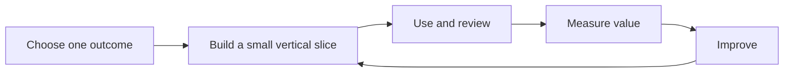

# From Tutorial to Real Practice

Document-as-Code is not a goal on its own. The goal is to make information easier to maintain, understand, reuse, and improve. The right starting point is a real problem where better information flow would help.

## Start with one useful outcome

Look for information that changes often, has several consumers, or requires repetitive checks. Examples include procedures shared across teams, release evidence, a roadmap built from maintained milestones, or a recurring management report.

Choose one outcome you can demonstrate. Avoid converting an entire document archive before you have learned how the new workflow performs.

## Build a small, complete path

The tutorial begins with three procedures and explores history, relationships, checks, outputs, and AI context through working examples and browser-only simulations. For your own implementation, build a small path that delivers one useful result:

1. Identify the information and its accountable owner.
2. Choose a readable, maintainable representation.
3. Define a small set of relationships and checks.
4. Generate one output that someone actually uses.
5. Review changes and measure whether the workflow improved.
6. Extend it only when the next use case justifies the effort.

*This is a conceptual illustration of the fictional scenario, not a live system.*

## Treat the workflow as a product

Information processing needs ownership too. Who maintains the templates? Who fixes a broken build? Who approves changes to rules? Which parts can teams improve without a central specialist? Define these responsibilities before the system becomes critical.

Make feedback part of normal work. Useful measures might include time to update a procedure, defects found before publication, time spent assembling a report, or the number of independently maintained copies eliminated. Do not optimize for commit counts or file counts without a clear reason.

## Keep governance clear and proportionate

Name who maintains the information, who may approve it, and who maintains its schema and processing code. These responsibilities may belong to different people. Review changes to checks and templates as well as changes to content, and retain decisions against the revisions they cover.

Agree access boundaries and what happens when a check or publication fails. A failed refresh should not silently replace a usable result with incomplete information. Label retained results with their age and failure state so consumers can decide whether to use them.

## Common ways to lose the benefit

| Failure | A better starting point |
| --- | --- |
| Move files into Git but leave ownership and reuse undefined. | Define one maintained source, an owner, and a useful output. |
| Treat valid syntax or a passing build as proof of accurate content. | Combine automated checks with review of meaning and suitability. |
| Build a platform before testing a real need. | Improve one recurring task and measure the result before expanding. |
| Make contribution depend on developer skills alone. | Offer accessible editors, examples, support, and review routes. |

## When another approach is simpler

Informal brainstorming, temporary notes, and one-off material may not justify a maintained processing workflow. Keep authoritative records in a suitable controlled system when access rules, specialist models, or existing review processes require it. Use links or controlled exports where they solve the problem; there is no need to replace every application.

## Where AI fits

AI can help draft changes, create scripts, and propose tests. Keep tasks bounded, supply relevant context, and check the outcome. Adoption is a change in how people work and make decisions, not just access to a new assistant.

## Explore: Plan a first increment

Write a short plan in your own editable file using these fields:

| Field | Your decision |
| --- | --- |
| Information | Which maintained item will you start with? |
| Owner | Who is accountable for its meaning and updates? |
| Primary consumer | Who needs the result? |
| Output | Which useful view will you generate first? |
| Initial check | What error should the process detect? |
| Evidence | What observable improvement would justify continuing? |

Review the plan with the owner and consumer. This is a planning exercise, not a readiness score.

## What to take away

The strongest Document-as-Code workflows make the source, its meaning, its history, its processing, and its published results understandable together. Start small, deliver a useful result, and improve the whole system as you learn.

<!-- interactive: chapter-quiz -->
