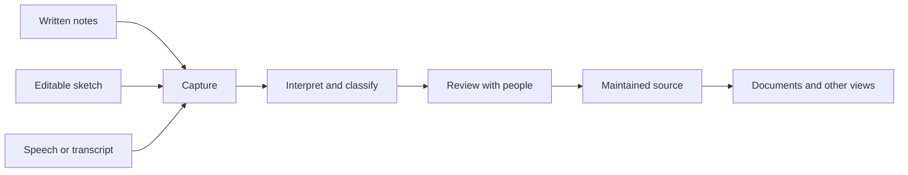

# From Thoughts to Sources: Write, Sketch, Speak

A team has just discussed how to improve its onboarding procedure. One person has written a few notes, another has drawn the proposed handover on a whiteboard, and a third has recorded the conversation. There may be useful information in all three places. None of it is yet an agreed procedure.

**Document-as-code begins before the document is written.** We need ways to collect early material without making every idea look like a verified fact. Sometimes the quickest way in is a keyboard. Sometimes a sketch explains a relationship better than a paragraph. And sometimes speaking is the easiest way to develop a thought.

> **Bonus chapter — optional deep dive.** The main learning journey has twelve lessons and a closing summary. This chapter extends the source-writing ideas in [Markdown: Readable Sources](04-markdown.md). You can follow the examples in a browser; VS Code, dictation, and transcription tools are optional.

## Three ways to capture one idea

| Starting point | Useful for | Typical source you keep | What needs checking |
| --- | --- | --- | --- |
| **Write** | Notes, requirements, procedures, observations, questions | Markdown or another readable text file | Is this a fact, a proposal, or someone's interpretation? |
| **Sketch** | Relationships, processes, layouts, alternatives, early concepts | An editable Excalidraw drawing | What does each shape or arrow mean, and what is missing? |
| **Speak** | Brainstorming, interviews, reflections, meeting discussion | Dictated notes or a recording and transcript | What was actually said, by whom, and what was decided? |

These are **capture methods**, not competing documentation strategies. A well-maintained source may begin with all three. The important change comes later, when someone interprets the material, identifies the information worth keeping, and reviews it.

A rough note can be valuable precisely because it is rough. If you ask an AI assistant to improve the language immediately, you may lose uncertainty, disagreement, or the distinction between something proposed and something decided.

## Write: start with readable text

[Visual Studio Code](https://code.visualstudio.com/) is a practical editor for source-based information work. Open a folder, create a file such as `notes/onboarding-ideas.md`, and write naturally. Markdown lets you add headings, lists, links, and simple tables as the material becomes clearer. VS Code can show a Markdown preview alongside the source.

For example, start with observations rather than forcing a finished specification:

```markdown
# Onboarding handover — working notes

## What we observed
- New colleagues sometimes wait for access approval.
- The manager and IT team track the request separately.

## Possible improvement
- Agree on a single request reference.

## Questions
- Who owns the request until access is granted?
- Is the delay measured, or only reported anecdotally?
```

This file can live in the same repository as the eventual maintained procedure. Git can later show when a suggestion was added or changed. Recording the note in Git does **not** make its contents accurate or approved.

**Try in your browser:** Create a Markdown file in a repository using GitHub's web editor, or use the existing [Markdown Playground](04-markdown.md#try-it-in-the-markdown-playground) without saving anything. The Playground is a safe place to explore formatting; a real repository is where you deliberately save and review changes.

**Optional VS Code workflow:** Use the Explorer to create the file, open Markdown Preview, and inspect the Source Control view to see the proposed difference. See the [official VS Code Markdown guide](https://code.visualstudio.com/docs/languages/markdown) for preview and authoring shortcuts. An AI assistant may help turn notes into a draft, but keep the original until you have checked the transformation.

## Sketch: capture what is easier to draw

Imagine the team discussing who passes a request to whom. It may be faster to draw three boxes—Employee, Manager, IT—and arrows showing the proposed handovers than to describe the process in prose.

[Excalidraw](https://excalidraw.com/) is a lightweight drawing tool suited to this kind of exploratory sketch. You can draw in the browser without first building a diagram in code. Its [VS Code extension](https://marketplace.visualstudio.com/items?itemName=pomdtr.excalidraw-editor) also lets you edit Excalidraw files inside your workspace.

For a repository-based workflow, choose an **editable source format** deliberately:

- `handover.excalidraw`: an editable drawing source.
- `handover.excalidraw.svg`: a drawing that can be displayed as SVG while retaining Excalidraw's embedded editable information when saved using that format.
- An ordinary exported `handover.svg` or `handover.png`: useful for display, but do not assume it retains editable Excalidraw scene data.

The extension supports `.excalidraw`, `.excalidraw.svg` and `.excalidraw.png` files. A drawing source can be versioned alongside the explanatory text, although visual changes may be harder to understand in a text diff than edits to Markdown.

**Try it:** Open Excalidraw in your browser, draw the three roles and two handovers, and label one arrow *proposed*. Save an editable copy where you control the source, then write a short Markdown note explaining the drawing. A person who cannot see the sketch should still be able to understand the proposed change from that note.

When the relationship becomes stable enough to maintain as structured information, a text-based diagram such as [Mermaid](https://mermaid.js.org/) may be a better fit for repeatable generation and clearer text diffs. You do not need to convert every exploratory sketch to Mermaid: use the representation that helps the team maintain the meaning.

## Speak: dictate or preserve a conversation

Speaking supports two different workflows. **Dictation** turns your words directly into editable text. **Transcription** turns an existing recording into a text record. They look similar on screen, but the record you need to preserve may differ.

### Dictate directly into an editor

VS Code documents a **Voice: Start Dictation in Editor** command for supported versions and platforms. Place the cursor in a writable Markdown file, start dictation from the Command Palette, speak, stop, and edit the resulting text. Its voice-support documentation explains platform support, shortcuts, experimental status, and local-versus-cloud processing.

This is useful for a quick reflection after a workshop or a first draft you want to speak rather than type. You can also speak to an AI agent in a voice conversation, but that is a different action: a spoken instruction to an agent is not necessarily saved as a reviewed document. Decide explicitly what should become a file.

**Optional tool:** [VS Code voice support and dictation](https://code.visualstudio.com/docs/configure/accessibility/voice). If built-in dictation is unavailable in your setup, an operating-system dictation feature or an accessible speech-to-text tool can provide the initial text. Check what service processes the audio before using workplace material.

### Start from a recording or transcript

For a longer discussion, keep the unedited transcript as a capture artifact when your permissions and retention rules allow it. A later summary is not a replacement for that record.

Consider this short **fictional** exchange:

```text
Manager: I think the new request should go through one queue.
IT: We could do that, but we have not agreed who would own it.
Manager: Let's take the ownership question to the next meeting.
```

A careless summary might say, *“The team decided to use a single queue.”* The conversation does not support that claim. A more useful extraction distinguishes the possibilities:

| Extracted item | Classification | Evidence |
| --- | --- | --- |
| A single queue was suggested | Proposal | Manager's first statement |
| Ownership has not been agreed | Open question | IT's response |
| Discuss ownership at the next meeting | Follow-up | Manager's final statement |

AI can help produce these categories, but its interpretation is still something a person must review. A transcript may also contain recognition errors, unclear speaker labels, or missing context. For consequential details, check against the original recording or participants rather than treating polished transcription as proof.

For programmatic processing of an existing recording, see the [OpenAI speech-to-text documentation](https://developers.openai.com/api/docs/guides/speech-to-text). This is one option, not a required part of the lab. Different tools have different data handling, language support, size limits, and access conditions.

**Privacy and permission:** Do not record or upload meetings, interviews, personal data, or confidential workplace discussions without the permissions and safeguards that apply. Local recognition and cloud transcription have different exposure and retention implications. Store raw recordings only when necessary and permitted; restrict access and define when they should be deleted.

## From captured material to maintained information

We now have notes, a sketch, and perhaps a transcript. It is tempting to drop them into an AI conversation and ask for the finished procedure. A more reliable path separates **what was captured** from **what the team now believes**.



For a small piece of work, the files might look like this:

```text
onboarding/
  capture/
    2026-11-21-notes.md
    handover.excalidraw.svg
    meeting-transcript.md
  decisions.md
  requesting-access.md
```

The folder names are illustrative, not a required repository convention. The files under `capture/` preserve the original context; `decisions.md` records what was actually agreed, with dates or references; `requesting-access.md` is the maintained procedure that other outputs can use.

The distinction matters: you may change a procedure tomorrow without rewriting what someone said in yesterday's meeting. You can still trace the procedure back to its rationale, subject to the access and retention rules for the original material.

### Use an agent to assist without losing evidence

An AI agent can be useful between capture and review. Give it a bounded task, such as:

> Read the supplied notes, drawing description, and transcript. Extract **observations**, **proposals**, **decisions**, and **open questions** into separate sections. Reference the source file and relevant passage for each item. If a statement is ambiguous or the material does not support a decision, say so. Do not edit the maintained procedure. Propose a draft for human review.

This works best when the agent receives the actual source material rather than a vaguely remembered conversation. The [AI agents chapter](08-ai-native.md) explains how project sources, terminology, instructions, and checks provide usable context. [Structured content](05-structured-content.md) then shows how fields such as owners and review states make maintained information easier to process.

A sketch may require someone to explain its meaning, or a tool capable of interpreting the drawing. Storing an editable Excalidraw file does **not** by itself give a text-only agent a reliable understanding of its arrows and shapes. Keep a concise description, and review any visual interpretation before using it as evidence.

## A small exercise: one idea, three inputs

Suppose your fictional team wants to improve the onboarding handover. Try these steps in a browser without setting up a development environment:

1. **Write:** Copy the working notes above into a temporary text file or editor. Add one question you think is missing.
2. **Sketch:** In [Excalidraw](https://excalidraw.com/), draw Employee → Manager → IT. Mark the uncertain handover with a question mark. Keep the editable drawing if you intend to return to it.
3. **Speak or read:** Say a short suggestion aloud and dictate it using a tool you already have, **or** use the fictional conversation above as a transcript. You do not need a microphone to complete the exercise.
4. **Classify:** Create a short table of observations, proposals, decisions, and questions. Compare the wording with the original input.
5. **Review:** Decide which items are sufficiently supported to enter the maintained procedure and which should remain unresolved.

The expected result is **not** a perfect procedure. It is a clearer boundary between raw material, interpretations, and information that has been reviewed. If a tool is unavailable, use text to describe the sketch or the spoken idea. The learning goal does not depend on installing an extension or using an AI account.

## Choose the smallest useful toolset

| Need | Starting point | Further information |
| --- | --- | --- |
| Write and review Markdown | Browser editor or VS Code | [VS Code Markdown](https://code.visualstudio.com/docs/languages/markdown) |
| Draw exploratory processes | Excalidraw in a browser | [Excalidraw](https://excalidraw.com/) |
| Keep drawings alongside text | Excalidraw extension for VS Code | [Extension documentation](https://github.com/excalidraw/excalidraw-vscode) |
| Dictate into a text editor | VS Code dictation, where supported | [VS Code voice support](https://code.visualstudio.com/docs/configure/accessibility/voice) |
| Transcribe an existing recording | A permitted speech-to-text tool | [Speech-to-text guide](https://developers.openai.com/api/docs/guides/speech-to-text) |
| Maintain a diagram as text | Mermaid | [Mermaid documentation](https://mermaid.js.org/) |

Writing, drawing, and speaking are different routes into the same information workflow. Keeping the capture material distinguishable from reviewed sources means you can experiment freely **without losing track of what was actually said, seen, proposed, or decided**.
